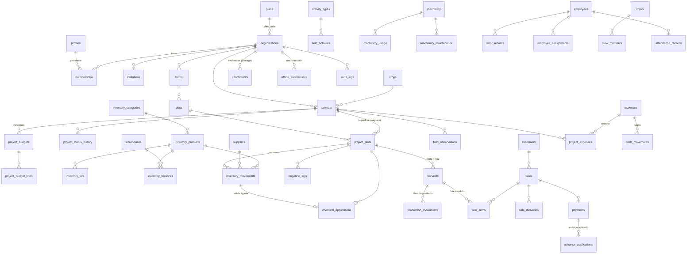

# Modelo de base de datos

PostgreSQL 17 en Supabase. 51 tablas, 8 vistas (todas `security_invoker`), 125 políticas RLS y ~100 funciones en el
esquema `public`. El detalle de reglas por módulo está en [arquitectura.md](arquitectura.md); aquí se resumen el modelo,
las migraciones y la seguridad a nivel de fila.

## Principios

1. **Multiempresa por `organization_id`.** Toda tabla de negocio lleva la organización y las relaciones usan llaves
   foráneas compuestas `(organization_id, id)`: aunque alguien conozca el id de otra organización, no puede referenciarlo.
2. **RLS en todas las tablas.** Lectura para miembros activos (`is_member`), escritura según rol (`has_role`). Las vistas
   son `security_invoker`, así que heredan la RLS del usuario.
3. **Escrituras sensibles por RPC.** Inventario, ventas, pagos, gastos, presupuestos y sincronización pasan por funciones
   `SECURITY DEFINER` con `search_path = ''`, que verifican rol, bloquean filas y corren en una transacción.
4. **Historial inmutable.** Movimientos de inventario y de producto, presupuestos, pagos y bitácoras no se borran: se
   cancelan o revierten con contrapartida y motivo. `audit_logs` guarda los cambios (trigger `log_audit`).
5. **Idempotencia.** Los registros operativos llevan un `id` generado en el dispositivo; reenviar no duplica.

## Diagrama entidad-relación (núcleo)

Vistas de lectura: `v_project_cost_entries` (única fuente de costos), `v_project_costs` (costos, producción, ventas,
cobranza, presupuesto y resultado por proyecto), `v_budget_comparison`, `v_sale_balances`, `v_sale_lot_trace`,
`v_inventory_stock`, `v_machinery_status`, `v_project_timeline`.

## Migraciones

| Archivo                                   | Contenido                                                                                  |
| ----------------------------------------- | ------------------------------------------------------------------------------------------ |
| `20261102000000_core.sql`                 | Organizaciones, perfiles, membresías, invitaciones, auditoría, funciones de autorización.   |
| `20261102010000_agro.sql`                 | Ranchos, parcelas, cultivos, proyectos, asignación de superficie, estados y folios.         |
| `20261102020000_finance.sql`              | Inventario, maquinaria, personal, gastos, cosechas, clientes, ventas, pagos, vistas de costo. |
| `20261102030000_operations_enums.sql`     | Valor de enum `transferencia` (archivo propio: PostgreSQL no usa un valor nuevo en la misma transacción). |
| `20261102030100_operations.sql`           | Almacenes, lotes, bitácoras, mantenimiento, cuadrillas, asistencia, evidencias y Storage.   |
| `20261103040000_commercial_enums.sql`     | Estados de venta.                                                                          |
| `20261103040100_commercial.sql`           | Lotes de producción, libro de producto, ventas con borrador y entregas, anticipos.          |
| `20261104050000_financial_enums.sql`      | Tipo de gasto `mantenimiento`.                                                             |
| `20261104050100_financial.sql`            | Presupuestos por versión, gastos compartidos, flujo de efectivo, alertas.                   |
| `20261105060000_platform.sql`             | **Fase 6:** observaciones de campo, `offline_submissions`, planes y límites, política de Storage corregida, índices de llaves foráneas. |
| `20261106070000_auditoria.sql`            | **Auditoría:** eliminar una organización con historial (reglas omitidas en la cascada, llaves `NO ACTION DEFERRABLE`, llave `payments → organizations`). |

Reglas para nuevas migraciones:

- Una migración por cambio de fase o funcionalidad; **nunca** editar una migración ya aplicada en producción.
- Los valores nuevos de un enum van en un archivo propio, antes de la migración que los usa.
- Cambios aditivos: columnas con valor por omisión, `create index` (en producción grande, `create index concurrently`
  en una migración separada), funciones con `create or replace`. Para eliminar columnas, primero dejar de usarlas en la
  aplicación y desplegar; eliminar en una migración posterior.
- Cada función `SECURITY DEFINER` lleva `set search_path = ''`, revoca `EXECUTE` a `public, anon` y lo otorga solo a
  `authenticated` si la aplicación la invoca.
- Agregar pruebas pgTAP en `supabase/tests/database/` y regenerar tipos con `npm run db:types`.

## Políticas RLS (resumen)

| Área                                             | Lectura                                   | Alta / edición                                         | Eliminación                 |
| ------------------------------------------------ | ----------------------------------------- | ------------------------------------------------------ | --------------------------- |
| Organización, membresías, invitaciones           | miembros                                  | propietario, administrador (RPC)                       | — (se desactiva)            |
| Ranchos, parcelas, cultivos, proyectos           | miembros                                  | propietario, administrador, agrónomo                    | propietario, administrador  |
| Inventario, almacenes, proveedores, lotes        | miembros                                  | propietario, administrador, almacén (RPC)              | propietario, administrador  |
| Bitácoras (riego, aplicación, actividad, observación) | miembros                             | propietario, administrador, agrónomo, supervisor       | — (se cancelan)             |
| Maquinaria, mantenimiento, cuadrillas, asignaciones | miembros                               | propietario, administrador, agrónomo                    | según tabla                 |
| Mano de obra, asistencia                         | miembros                                  | + supervisor                                           | según tabla                 |
| Cortes y mermas                                  | miembros                                  | campo (cortes), + almacén (mermas)                     | lote sin historial          |
| Clientes, ventas, pagos, gastos, presupuestos, flujo | propietario, administrador, finanzas, consulta | propietario, administrador, finanzas (RPC)      | — (se cancelan)             |
| Evidencias de campo                              | miembros                                  | roles de captura                                       | autor con rol vigente, propietario, administrador |
| Comprobantes (pagos y gastos)                    | roles financieros                         | propietario, administrador, finanzas                   | propietario, administrador  |
| `offline_submissions`                            | autor; revisores (propietario, administrador, agrónomo) | solo RPC `save_offline_submission`       | — (`discard_offline_submission`) |
| `plans`                                          | autenticados                              | nadie desde la app (clave secreta / SQL)                | —                           |
| `audit_logs`                                     | propietario, administrador                | solo triggers                                          | —                           |

Storage (`evidencias`, privado, 10 MB, JPG/PNG/WEBP/HEIC y PDF solo para comprobantes): la ruta
`organización/tipo/registro/archivo` determina organización y rol; leer exige membresía (y rol financiero para
comprobantes); subir exige el rol de captura del tipo; eliminar exige ser el autor con rol vigente o propietario/administrador.

## Índices

Además de las llaves primarias y únicas, cada tabla de registros tiene índice `(organization_id, fecha desc)` para los
listados por periodo y `(project_id, fecha desc)` para el expediente. La Fase 6 agregó índices parciales para las llaves
foráneas que se verifican al eliminar catálogos (proveedores, empleados, tipos de actividad, equipos, cuadrillas,
almacenes), de modo que eliminar un registro sin uso no recorra tablas completas.

## Pruebas

`npm run test:db` ejecuta 8 archivos pgTAP (450 pruebas): RLS por rol y organización, reglas de superficie, inventario,
costos sin duplicidad, ventas y existencias concurrentes, presupuestos, sincronización sin conexión y límites por plan.
