# Manual de Usuario - AgroGestión 360

Versión piloto · noviembre de 2026

Este manual explica cómo usar AgroGestión 360 paso a paso. Está escrito para propietarios, administradores, agrónomos,
supervisores de campo y personal administrativo de empresas agrícolas. No hace falta tener conocimientos técnicos.

Los nombres de pantallas, botones y campos se contrastaron con el código de cada pantalla y aparecen **en negritas**,
igual que en la aplicación. Los procedimientos principales se ejecutaron en la aplicación el 5 de noviembre de 2026
(ver la [Matriz de resultados](../pruebas/matriz_resultados_pruebas.md)). Si una función tiene limitaciones, se indica con un recuadro **«Limitación»**.
El detalle técnico de qué está terminado y qué no está en el [Anexo A](#anexo-a-estado-de-los-módulos) y en el
[Inventario de funcionalidades](../analisis/inventario_funcionalidades.md).

**Capturas de pantalla.** Son capturas reales de la aplicación (compilación de producción local, 5 de noviembre de
2026). Usan la organización de demostración «Agropecuaria Los Campos» con datos ficticios. Las tomadas en computadora
son de 1440 × 900 px a doble densidad; las de teléfono simulan un Pixel 7. Los campos de fecha aparecen como
mm/dd/aaaa porque el navegador de captura no aplicó el idioma español; en un navegador configurado en español de
México se muestran como dd/mm/aaaa. Están en `docs/manual/images/`.

**Contenido**

- [1. Introducción](#1-introducción)
- [2. Requisitos para utilizar la aplicación](#2-requisitos-para-utilizar-la-aplicación)
- [3. Acceso al sistema](#3-acceso-al-sistema)
- [4. Conocimiento de la interfaz](#4-conocimiento-de-la-interfaz)
- [5. Administración de proyectos agrícolas](#5-administración-de-proyectos-agrícolas)
- [6. Administración de ranchos y parcelas](#6-administración-de-ranchos-y-parcelas)
- [7. Administración de inventarios](#7-administración-de-inventarios)
- [8. Bitácoras agrícolas](#8-bitácoras-agrícolas)
- [9. Administración de maquinaria](#9-administración-de-maquinaria)
- [10. Administración de recursos humanos](#10-administración-de-recursos-humanos)
- [11. Cortes de producción y cosechas](#11-cortes-de-producción-y-cosechas)
- [12. Administración de clientes y ventas](#12-administración-de-clientes-y-ventas)
- [13. Control de pagos y cuentas por cobrar](#13-control-de-pagos-y-cuentas-por-cobrar)
- [14. Costos y presupuestos](#14-costos-y-presupuestos)
- [15. Dashboard y reportes](#15-dashboard-y-reportes)
- [16. Usuarios y permisos](#16-usuarios-y-permisos)
- [17. Problemas frecuentes](#17-problemas-frecuentes)
- [Anexo A. Estado de los módulos](#anexo-a-estado-de-los-módulos)

**Convenciones**

- **Menú → Opción**: ruta que debes seguir en el menú lateral. Ejemplo: **Operación → Inventario**.
- Pestaña **X**: pestaña dentro de una pantalla. Ejemplo: pestaña **Movimientos**.
- Los ejemplos usan datos ficticios.

---

## 1. Introducción

### 1.1 Qué es AgroGestión 360

AgroGestión 360 es una aplicación web para administrar empresas agrícolas. En un solo lugar reúne:
- La planeación de cada ciclo de cultivo.
- El campo: insumos, riegos, aplicaciones, labores, maquinaria y personal.
- La cosecha.
- Las ventas, la cobranza y los resultados económicos.

Se usa desde el navegador de una computadora, un teléfono o una tableta. También puede instalarse en el teléfono como
aplicación para registrar trabajo de campo donde no hay señal.

### 1.2 Para qué sirve y qué problemas resuelve

| Problema habitual | Cómo ayuda AgroGestión 360 |
| ----------------- | -------------------------- |
| No se sabe cuánto costó realmente un cultivo | Cada consumo de insumos, hora de maquinaria, jornal y gasto se carga al proyecto. El costo por hectárea y por kilo se calcula solo. |
| Las libretas de campo se pierden o no se pasan a limpio | Las bitácoras de riego, aplicaciones, actividades y observaciones se registran con fecha, parcela, responsable y fotografías. |
| No hay señal en el campo | La **Captura en campo** guarda los registros en el teléfono y los envía cuando vuelve la conexión. |
| El inventario no cuadra | Cada entrada, salida y transferencia queda registrada. Los errores se anulan con un movimiento contrario, sin borrar nada. |
| Se vende más de lo que hay o no se sabe de qué parcela salió el producto | Cada corte genera un lote. Las ventas descuentan de lotes y se puede rastrear de qué parcela salió cada venta. |
| Se confunde lo vendido con lo cobrado | Ventas, cobranza, cuentas por cobrar y resultado se muestran por separado. |
| El presupuesto se rebasa sin aviso | El presupuesto se compara contra el costo real, con alertas configurables. |

### 1.3 A quién está dirigido

A empresas agrícolas de cualquier tamaño, y dentro de ellas a:
- **Propietarios y administradores**, que consultan resultados y administran usuarios.
- **Agrónomos**, que planean proyectos, cultivos, parcelas, maquinaria y personal.
- **Supervisores de campo**, que registran bitácoras, jornadas y cortes.
- **Encargados de almacén**, que registran compras, salidas y transferencias.
- **Personal de finanzas y ventas**, que registra presupuestos, gastos, ventas y pagos.

### 1.4 Beneficios

- **Una sola captura.** Lo que se registra en un módulo alimenta los costos, los reportes y los indicadores; no se
  vuelve a capturar.
- **Información confiable.** Las reglas se validan al guardar. Por ejemplo, no se puede consumir más de lo que hay ni
  asignar más superficie de la que tiene una parcela.
- **Historial completo.** Los movimientos importantes no se borran: se cancelan o se revierten, y queda el motivo.
- **Separación por empresa.** Cada organización ve solo su información.
- **Permisos por rol.** Cada persona ve y registra solo lo que le corresponde.

### 1.5 Operaciones que permite administrar

| Área | Módulos |
| ---- | ------- |
| General | Dashboard, notificaciones |
| Producción agrícola | Proyectos, Ranchos y parcelas, Cultivos |
| Operación | Inventario, Bitácoras, Captura en campo, Sincronización, Maquinaria, Personal |
| Comercialización | Dashboard comercial, Producción (cortes y lotes), Clientes, Ventas, Cobranza |
| Finanzas | Dashboard financiero, Presupuestos, Gastos, Rentabilidad, Flujo de efectivo, Reportes financieros, Reportes operativos |
| Configuración | Organización, Usuarios y roles, Mi perfil |

---

## 2. Requisitos para utilizar la aplicación

### 2.1 Navegadores

| Navegador | Situación |
| --------- | --------- |
| Google Chrome (computadora) | Probado con pruebas automatizadas del proyecto. Recomendado. |
| Chrome en Android | Probado en simulación de teléfono (Pixel 7). Recomendado para campo. |
| Microsoft Edge, Firefox, Safari (actualizados) | Admitidos por la captura sin conexión, pero no se probaron con pruebas automatizadas. |

Usa siempre la versión más reciente del navegador. Si el navegador no puede guardar información en el dispositivo, la
**Captura en campo** muestra el aviso «**Navegador no compatible**».

### 2.2 Computadora

- Cualquier computadora capaz de ejecutar un navegador actual.
- Pantalla de 1280 px de ancho o más para ver las tablas completas. En pantallas más angostas, algunas columnas se
  ocultan.

### 2.3 Teléfono o tableta

- Android con Chrome actualizado, o iPhone/iPad con Safari actualizado.
- Cámara, si se van a tomar fotografías de evidencia.
- Espacio libre suficiente para guardar registros y fotos mientras no haya señal.
- Ubicación (GPS) opcional: solo se usa en las observaciones de campo, con el botón **Usar mi ubicación**.

### 2.4 Conexión a Internet

- Casi toda la aplicación necesita conexión: dashboards, inventario, ventas, finanzas, configuración.
- Sin conexión solo funciona **Captura en campo**. Las demás pantallas muestran «**Sin conexión** — Esta sección
  necesita internet» con el botón **Ir a captura en campo**.

### 2.5 Instalar la aplicación (PWA)

La aplicación se puede instalar en el teléfono o la computadora para abrirla como cualquier otra app.

- **Chrome o Edge (Android y computadora):** pulsa **Instalar app** en la barra superior y acepta el aviso del navegador.
- **iPhone o iPad (Safari):** pulsa **Instalar app**. Se abre **Instalar AgroGestión 360** con dos pasos:
  1. Toca **Compartir** en Safari.
  2. Elige **Agregar a pantalla de inicio**.

> **Limitación.** El botón **Instalar app** solo aparece cuando la aplicación está publicada en un servidor de producción.
> La instalación en un teléfono real todavía no se ha verificado (ver Anexo A).

### 2.6 Consideraciones para el modo sin conexión

- **Primera vez con conexión.** Antes de salir al campo, abre **Captura en campo** con internet y tu sesión iniciada. Así
  se descargan al teléfono tus proyectos, parcelas y catálogos.
- **Qué se puede capturar sin señal:**
  - Riego.
  - Actividad.
  - Aplicación de agroquímicos.
  - Observación.
  - Corte de producción.
- **Qué no se puede capturar sin señal:** jornadas, uso de maquinaria, ventas, pagos, gastos y movimientos de
  inventario.
- **En iPhone, instala la aplicación.** Safari puede borrar los datos de sitios no instalados que no se usan en varios
  días.
- **Sincroniza a diario.** Los registros pendientes solo existen en ese teléfono hasta que se envían.
- **Al cerrar sesión con registros pendientes** aparece un aviso. Los registros se conservan en el dispositivo y se
  envían cuando vuelvas a iniciar sesión con la misma cuenta.

---

## 3. Acceso al sistema

### 3.1 Cómo ingresar a la aplicación

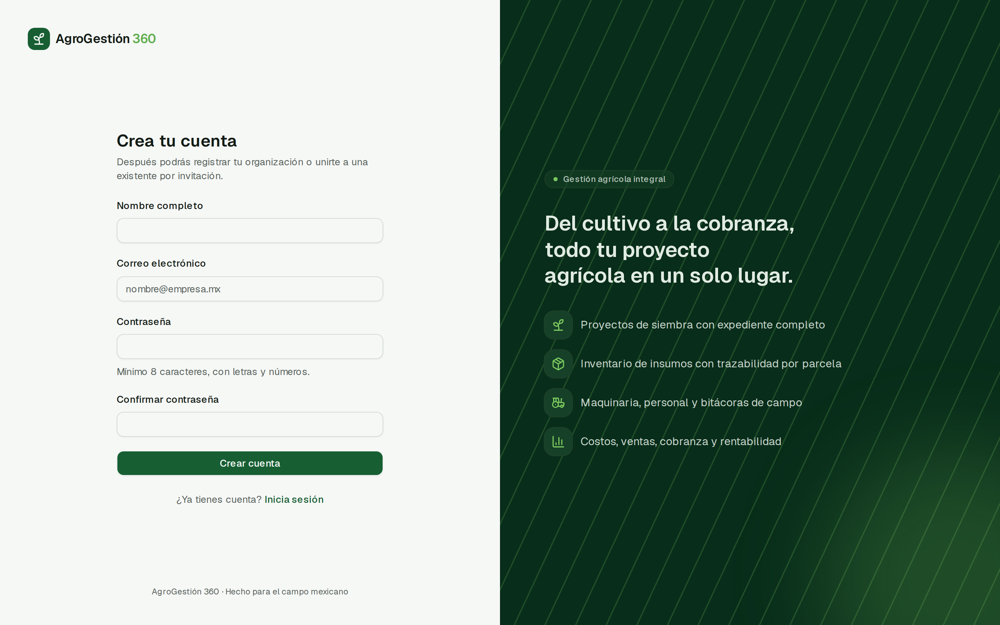

1. Abre el navegador y escribe la dirección que te dio el administrador de tu empresa.
2. Si no has iniciado sesión, la aplicación te lleva a **Bienvenido de nuevo** (inicio de sesión).

Si tu empresa todavía no usa AgroGestión 360, puedes crear una cuenta:
1. En la pantalla de inicio de sesión, pulsa **Regístrate**. Se abre **Crea tu cuenta**.
2. Captura **Nombre completo**, **Correo electrónico**, **Contraseña** y **Confirmar contraseña**. La contraseña debe
   tener mínimo 8 caracteres, con letras y números.
3. Si el sistema pide confirmar el correo, verás «**Revisa tu correo**». Abre el enlace que te llegó.
4. Al entrar por primera vez sin pertenecer a ninguna empresa, aparece **Bienvenido**.
5. Escribe el **Nombre de la organización** y pulsa **Crear organización**. Quedarás como **Propietario**.

Si te invitaron a una empresa que ya existe:
1. Abre el enlace del correo de invitación. Verás «**Activando tu invitación…**».
2. Define tu contraseña en **Crea tu nueva contraseña**.
3. Entrarás directamente con el rol que te asignaron.

> **Limitación.** Los correos de invitación y de recuperación usan, por ahora, las plantillas estándar del servicio de
> correo, que están en inglés.

### 3.2 Cómo iniciar sesión

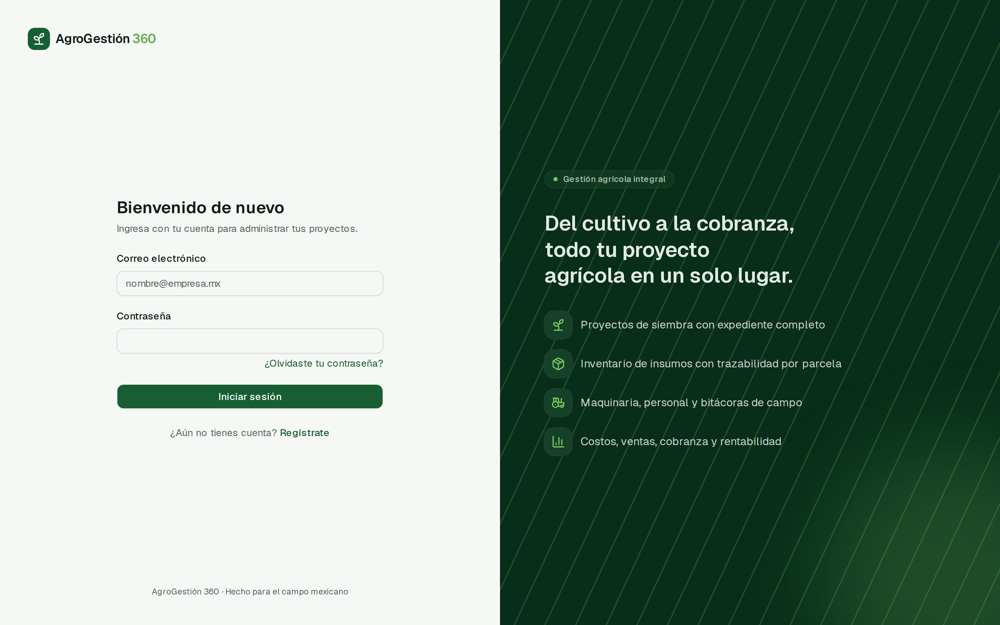

1. En **Bienvenido de nuevo**, escribe tu **Correo electrónico** y tu **Contraseña**.
2. Pulsa **Iniciar sesión**.
3. Entrarás al **Dashboard**. Si intentabas abrir otra pantalla, la aplicación te lleva a esa pantalla.

### 3.3 Cómo cerrar sesión

1. En la barra superior, pulsa tu nombre (**Menú de usuario**, a la derecha).
2. Elige **Cerrar sesión**.
3. Si tienes registros de campo sin sincronizar, aparecerá: «Tienes N registros sin sincronizar. Se conservarán en este
   dispositivo y se enviarán cuando vuelvas a iniciar sesión. ¿Cerrar sesión?».

Al cerrar sesión se borran del dispositivo la sesión y los catálogos descargados.

### 3.4 Cómo recuperar la contraseña

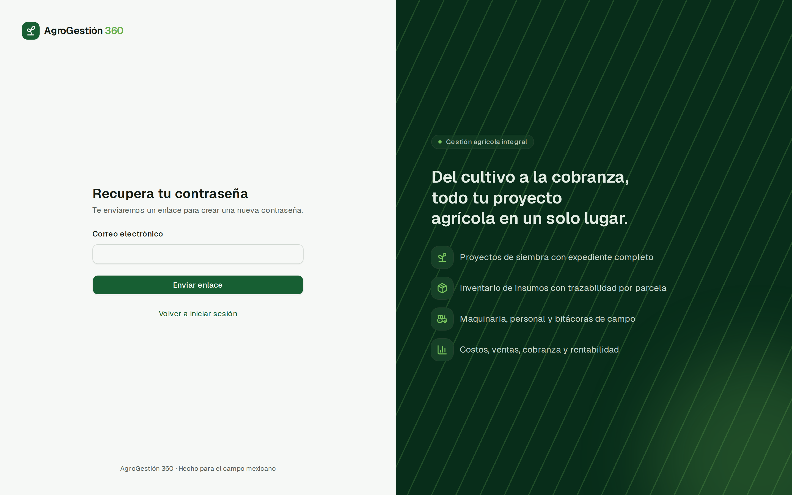

1. En la pantalla de inicio de sesión pulsa **¿Olvidaste tu contraseña?**.
2. En **Recupera tu contraseña** escribe tu **Correo electrónico** y pulsa **Enviar enlace**.
3. Verás: «Si el correo está registrado, recibirás un enlace para restablecer tu contraseña». El mensaje es el mismo
   aunque el correo no exista; así nadie puede averiguar qué correos están registrados.
4. Abre el enlace del correo. En **Crea tu nueva contraseña** captura **Nueva contraseña** y **Confirmar contraseña**.
5. Si el enlace ya caducó, verás «El enlace expiró. Solicita uno nuevo para restablecer tu contraseña».

> **Limitación.** El envío real del correo depende de la configuración del servidor de correo y no se verificó en este
> manual (Anexo A).

### 3.5 Cómo actualizar los datos del perfil

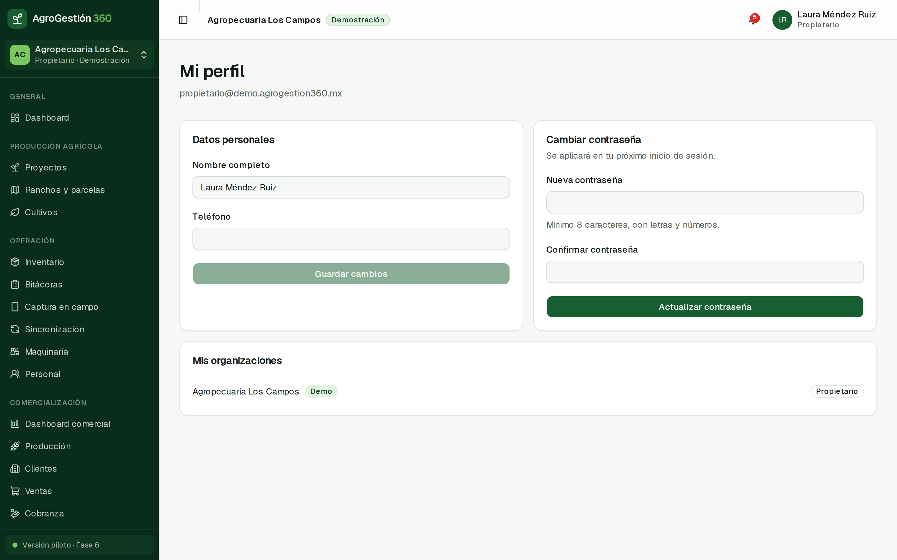

1. Abre **Menú de usuario → Mi perfil**, o **Configuración → Mi perfil**.
2. En **Datos personales**, modifica **Nombre completo** o **Teléfono** y guarda.
3. Para cambiar la contraseña, usa **Cambiar contraseña**: captura **Nueva contraseña** y **Confirmar contraseña**, y
   pulsa **Actualizar contraseña**. La nueva contraseña debe ser diferente de la anterior.
4. **Mis organizaciones** muestra las empresas a las que perteneces.

> **Limitación.** No se puede subir una foto de perfil. El círculo de la barra superior muestra tus iniciales.

### 3.6 Cómo identificar mensajes de error

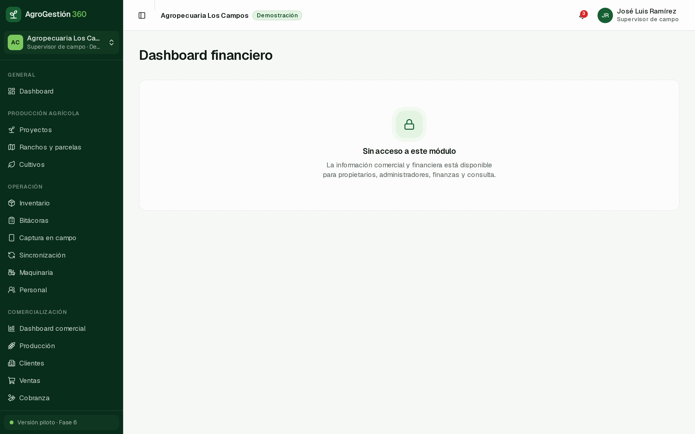

La aplicación avisa de tres formas:

| Dónde aparece | Ejemplo | Qué hacer |
| ------------- | ------- | --------- |
| Debajo del campo, en rojo | «Campo obligatorio», «Selecciona una fecha», «Ingresa un número válido» (por ejemplo, una cantidad negativa), «Debe ser mayor que cero», «No puede ser una fecha futura» | Corrige ese campo y vuelve a guardar. |
| Aviso flotante en una esquina (verde = éxito, rojo = error) | «Correo o contraseña incorrectos.», «Existencia insuficiente de "Urea 46 %": hay 5000.000 kg y se requieren 6000» | Lee el motivo: casi siempre indica qué cifra o dato no cuadra. Algunos de estos avisos muestran las cantidades sin separador de miles y con tres decimales («5000.000» significa 5,000). |
| Mensaje en la pantalla | «**Sin acceso a este módulo**» | Tu rol no puede consultar esa información. Consulta el capítulo 16. |

Mensajes generales frecuentes:

| Mensaje | Significado |
| ------- | ----------- |
| «Revisa los datos marcados en el formulario.» | Hay campos con error. |
| «No tienes permiso para realizar esta operación.» | Tu rol no permite ese registro. |
| «Ya existe un registro con esos datos.» | Intentas duplicar un registro, por ejemplo una clave o un nombre ya usados. |
| «El registro está relacionado con información que no existe o no puede eliminarse.» | El registro tiene historial. Desactívalo en lugar de eliminarlo. |
| «Ocurrió un error inesperado. Intenta de nuevo.» | Falla de conexión o del servidor. Ver el capítulo 17. |

---

## 4. Conocimiento de la interfaz

### 4.1 Estructura de la pantalla

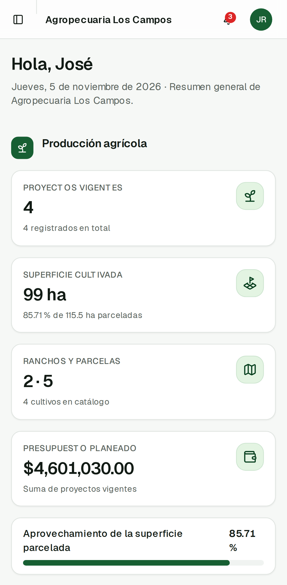

```
┌──────────────┬──────────────────────────────────────────────────────────────┐
│ Organización │ ☰ │ Nombre de la organización   [estado] [Instalar app] 🔔 👤 │  ← barra superior
│ (selector)   ├──────────────────────────────────────────────────────────────┤
│              │  Título de la pantalla                       [Botón principal] │
│ Menú lateral │  Descripción                                                  │
│  General     │  [Indicadores]                                                │
│  Producción  │  [Filtros: Desde · Hasta · Proyecto…  Aplicar · Limpiar]      │
│  Operación   │  [Pestañas]                                                   │
│  …           │  [Tabla / gráficas]                                           │
└──────────────┴──────────────────────────────────────────────────────────────┘
```

### 4.2 Dashboard principal

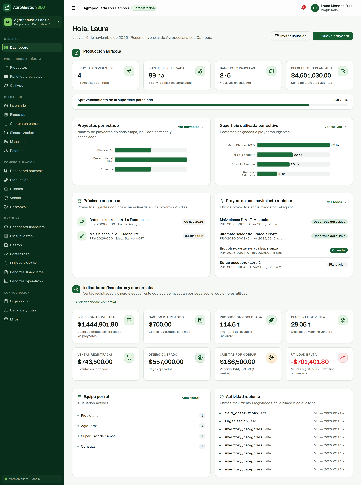

Es la primera pantalla después de iniciar sesión. Saluda con tu nombre («**Hola, …**») y muestra la fecha. Tiene:

- **Producción agrícola:**
  - Indicadores **Proyectos vigentes**, **Superficie cultivada**, **Ranchos y parcelas** y **Presupuesto planeado**.
  - Barra de **Aprovechamiento de la superficie parcelada**.
  - Gráficas **Proyectos por estado** y **Superficie cultivada por cultivo**.
  - Lista de **Próximas cosechas** (próximos 45 días).
  - **Proyectos con movimiento reciente**.
- **Indicadores financieros y comerciales** (solo roles con acceso a finanzas):
  - **Inversión acumulada**, **Gastos del periodo**, **Producción cosechada**, **Pendiente de venta**.
  - **Ventas registradas**, **Dinero cobrado**, **Cuentas por cobrar** y **Utilidad bruta**.
- **Equipo por rol**: cuántas personas hay en cada rol. Propietario y Administrador ven además el enlace **Administrar**.
- **Actividad reciente** (solo Propietario y Administrador): últimos movimientos guardados en la bitácora de auditoría.

### 4.3 Menú de navegación (lateral)

Las opciones están agrupadas así:

| Grupo | Opciones |
| ----- | -------- |
| General | Dashboard |
| Producción agrícola | Proyectos · Ranchos y parcelas · Cultivos |
| Operación | Inventario · Bitácoras · Captura en campo · Sincronización · Maquinaria · Personal |
| Comercialización | Dashboard comercial · Producción · Clientes · Ventas · Cobranza |
| Finanzas | Dashboard financiero · Presupuestos · Gastos · Rentabilidad · Flujo de efectivo · Reportes financieros · Reportes operativos |
| Configuración | Organización · Usuarios y roles · Mi perfil |

- El botón **☰** de la barra superior oculta o muestra el menú. En el teléfono, el menú se abre como panel lateral.
- En la parte superior del menú está el **selector de organización**. Si perteneces a varias empresas, ábrelo y elige otra
  (la actual aparece como **Activa**). Desde ahí también puedes **Crear organización**.
- Todas las opciones aparecen para todos los roles. Si tu rol no puede consultar una pantalla, al abrirla verás
  «**Sin acceso a este módulo**».

### 4.4 Barra superior

De izquierda a derecha:
- El botón **☰**.
- El **nombre de la organización**. Una etiqueta **Demostración** indica que contiene datos ficticios.
- El **indicador de conexión**. Solo aparece cuando hay algo que avisar:
  - **Sin conexión** en rojo.
  - **N por sincronizar** en ámbar.

  Al pulsarlo se abre **Captura en campo**.
- El botón **Instalar app**, cuando el navegador lo permite.
- La **campana de notificaciones**.
- El **Menú de usuario**.

### 4.5 Perfil de usuario (Menú de usuario)

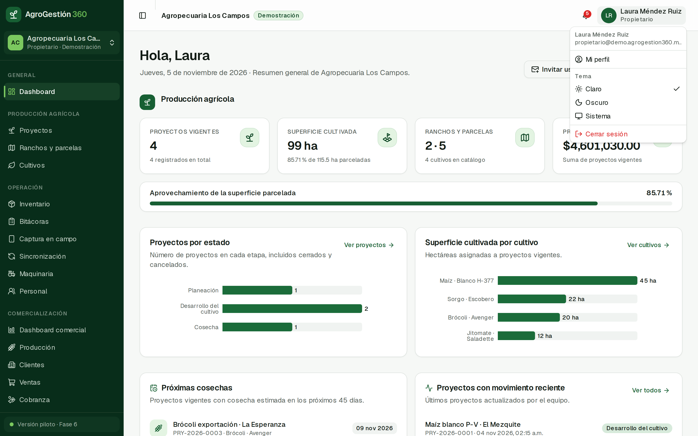

Al pulsar tu nombre o tus iniciales se abre un menú con:
- Tu nombre y correo.
- **Mi perfil**.
- **Tema**: **Claro**, **Oscuro** o **Sistema**.
- **Cerrar sesión**.

### 4.6 Notificaciones

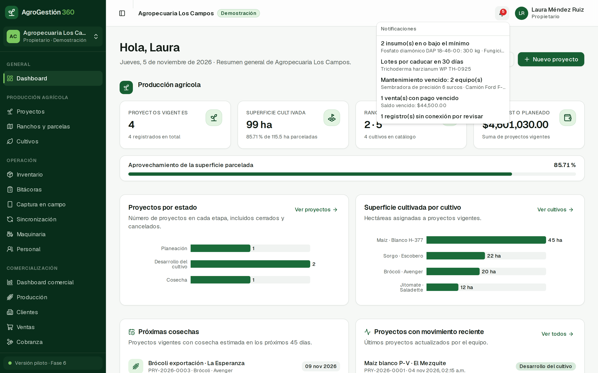

La campana muestra un número rojo con las alertas vigentes. Al pulsarla se abre **Notificaciones**. Cada alerta lleva a
la pantalla donde se atiende. Las alertas son:

| Alerta | Quién la ve | Lleva a |
| ------ | ----------- | ------- |
| Insumos en o bajo el mínimo | Todos | Inventario |
| Lotes de insumo por caducar en 30 días o caducados | Todos | Inventario → **Por almacén y lote** |
| Mantenimiento de maquinaria vencido o próximo | Todos | Maquinaria |
| Ventas con cobranza vencida | Roles con acceso a finanzas | Cobranza |
| Presupuestos en estado crítico o agotado | Roles con acceso a finanzas | Presupuestos |
| Registros sin conexión que requieren revisión | Propietario, Administrador, Agrónomo | Sincronización |

Las alertas se calculan cada vez que se carga la página y desaparecen solas cuando se resuelve la causa. Si no hay
alertas verás «No tienes notificaciones pendientes».

> **Limitación.** Las notificaciones solo se ven dentro de la aplicación: no se envían por correo ni al teléfono.

### 4.7 Indicadores

Las tarjetas de la parte superior de cada pantalla muestran una cifra grande y, debajo, una aclaración (por ejemplo
«Existencia × costo promedio»). Algunas cambian de color:
- **Verde:** un buen resultado, como el dinero cobrado.
- **Ámbar:** un aviso, como un lote por caducar.
- **Rojo:** un problema, como un saldo vencido o un resultado negativo.

### 4.8 Tablas

- Muestran los registros más recientes primero.
- En pantallas angostas se ocultan columnas secundarias; la información completa sigue en la computadora.
- La última columna tiene botones de acción con íconos. Al pasar el cursor se ve su nombre:
  - Lápiz = **Editar**.
  - Papelera = **Eliminar**.
  - Cámara = **Evidencias**.
  - Flecha circular = **Anular** o **Revertir**.
  - Clip = **Comprobantes**.
- Los registros cancelados se conservan con la etiqueta **Cancelado**, **Anulado** o **Revertido**.

### 4.9 Formularios

- Se abren en una ventana (**Registrar…**, **Nuevo…**, **Editar…**) o en una página propia (**Nuevo proyecto**,
  **Nueva venta**, presupuestos).
- Los campos marcados como **(opcional)** pueden quedar vacíos.
- El texto gris bajo un campo explica qué capturar (por ejemplo «Vacío = tarifa del equipo»).
- Los selectores de **Proyecto** y **Parcela** van juntos: primero elige el proyecto. La parcela muestra «Primero elige el
  proyecto» hasta que lo hagas.
- El botón de guardar se desactiva mientras se envía la información. **Cancelar** cierra sin guardar.

### 4.10 Filtros

Muchas pantallas tienen una barra de filtros con:
- **Desde** y **Hasta**: rango de fechas.
- Uno o más selectores, como **Proyecto**, **Cultivo**, **Almacén** o **Producto**.
- Los botones **Aplicar** y **Limpiar**.

Para usarlos:
1. Elige las fechas y opciones.
2. Pulsa **Aplicar**. La consulta se hace en el servidor.
3. **Limpiar** quita los filtros y conserva la pestaña en la que estás.

Además, algunas tablas tienen filtros rápidos propios, por ejemplo **Todos los estados**, **Solo bajo mínimo**,
**Mostrar cancelados** o **Solo con existencia**.

### 4.11 Búsquedas

Las tablas largas tienen un cuadro de búsqueda (por ejemplo «Buscar por folio, nombre, cultivo o rancho»). La lista se
filtra mientras escribes, sin necesidad de pulsar ningún botón.

### 4.12 Paginación

Cuando una tabla tiene más de 50 registros, al pie aparece:
- «1–50 de 230».
- Los botones **Anterior** y **Siguiente**, con «Página 1 de 5».

Si una consulta llega al máximo de 5,000 registros, verás «Se alcanzó el máximo de 5,000 registros: acota el periodo».
En ese caso, reduce el rango de fechas.

### 4.13 Ventanas de confirmación

Las operaciones delicadas piden confirmación en una ventana con título, explicación y dos botones: **Cancelar** y la
acción (por ejemplo **Eliminar**, **Anular**, **Confirmar venta**).
- Lee la explicación: indica qué pasará. Por ejemplo, «Se registrará la contrapartida exacta… Ambos movimientos quedan en
  el historial».
- Las anulaciones, cancelaciones y reversiones (por ejemplo **Anular movimiento**, **Cancelar venta**, **Cancelar
  pago**, **Revertir aplicación**, **Descartar registro**) piden un **Motivo** de al menos 5 caracteres, que queda
  guardado en el historial.

### 4.14 Cómo desplazarse entre módulos

- Usa el menú lateral para cambiar de módulo.
- Las pestañas cambian de vista sin salir de la pantalla. La pestaña elegida queda en la dirección del navegador, así
  que puedes guardarla en favoritos o compartirla.
- Los enlaces dentro de las pantallas llevan al detalle relacionado. Por ejemplo, en el expediente de un proyecto,
  **Ver cortes** lleva a Producción y **Ver todo** lleva a la cronología.
- Las pantallas de detalle tienen un enlace para volver al listado. También puedes usar el botón Atrás del navegador.

---

## 5. Administración de proyectos agrícolas

Un **proyecto** es un ciclo de cultivo: un cultivo y variedad, sembrado en una o varias parcelas, con fechas, responsable,
presupuesto y metas. Todo lo que se registra después (insumos, riegos, jornales, cortes, ventas) se liga a un proyecto.

**Quién puede:** Propietario, Administrador y Agrónomo crean y editan. Solo Propietario y Administrador eliminan y reabren.
Los demás roles solo consultan.

**Ejemplo de este capítulo:** Proyecto **Producción de jitomate**, cultivo **Jitomate · Saladette**, 5 ha en la parcela
**Parcela Norte** del **Rancho Los Campos**, presupuesto de $250,000.

> **Antes de empezar.** Deben existir el rancho, la parcela (capítulo 6) y el cultivo (sección 5.2).

### 5.1 Cómo registrar un proyecto

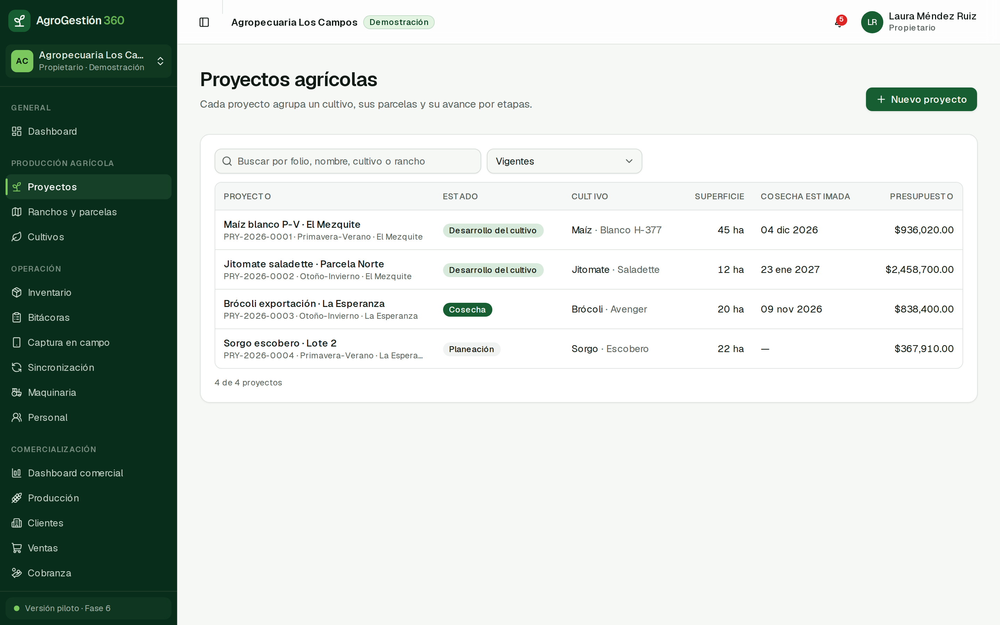
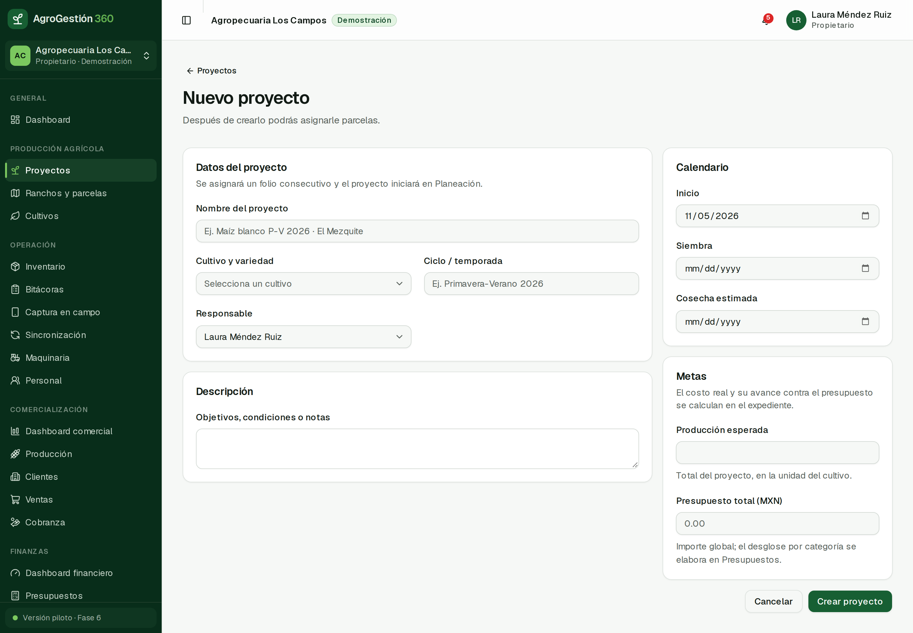

1. Ve a **Producción agrícola → Proyectos** y pulsa **Nuevo proyecto**. Si no hay cultivos registrados, verás «Primero
   registra un cultivo» con el enlace **Ir a cultivos**.
2. En **Datos del proyecto** captura:
   - **Nombre del proyecto**: «Producción de jitomate».
   - **Cultivo y variedad**: ver 5.2.
   - **Ciclo / temporada**: por ejemplo «Primavera-Verano 2026».
   - **Responsable**: ver 5.6.
3. En **Descripción**, en **Objetivos, condiciones o notas**, escribe lo que consideres útil.
4. En **Calendario** captura las fechas (ver 5.5).
5. En **Metas** captura:
   - **Producción esperada**: en la unidad del cultivo, por ejemplo cajas.
   - **Presupuesto total (MXN)**: 250000.
6. Pulsa **Crear proyecto**. La aplicación le asigna un **folio consecutivo** y el proyecto queda en estado
   **Planeación**. Después abre el expediente del proyecto.

### 5.2 Cómo seleccionar un cultivo

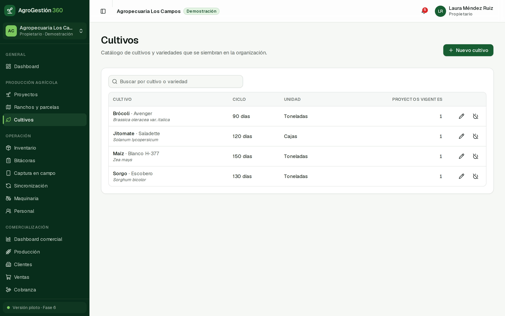

En **Cultivo y variedad** se ofrecen los cultivos activos del catálogo, con su variedad (por ejemplo «Jitomate ·
Saladette»). Al elegir uno, debajo aparece su ciclo aproximado (por ejemplo «Ciclo aproximado: 120 días»).

Si el cultivo no existe, regístralo primero:
1. Ve a **Producción agrícola → Cultivos** y pulsa **Nuevo cultivo**.
2. Captura:
   - **Cultivo**: Jitomate.
   - **Variedad**: Saladette.
   - **Nombre científico** (opcional).
   - **Ciclo (días)**: 120.
   - **Unidad de producción**: Toneladas, Kilogramos, Cajas, Sacos / arpillas o Piezas.
   - **Notas**.
3. Pulsa **Registrar cultivo**.

Registra cada variedad por separado para comparar su rendimiento entre proyectos. Un cultivo que ya se usa en proyectos
no se puede eliminar (el botón **Eliminar** no aparece en su fila): solo **desactivarse**, y entonces deja de
ofrecerse en proyectos nuevos.

### 5.3 Cómo agregar una parcela al proyecto

1. En el expediente del proyecto (sección 5.8), tarjeta **Parcelas asignadas**, pulsa **Asignar parcela**.
2. En **Parcela** elige, por ejemplo, «Rancho Los Campos · Parcela Norte (5 ha libres)». Solo aparecen parcelas con
   superficie libre.
3. Captura la **Superficie a asignar (ha)** (ver 5.4) y pulsa **Asignar**.

Si **Asignar parcela** aparece desactivado con el aviso «No hay parcelas con superficie disponible», registra o libera
parcelas en **Ranchos y parcelas**.

### 5.4 Cómo registrar la superficie

La superficie del proyecto es la suma de las hectáreas asignadas en cada parcela. En el ejemplo, captura **5** en
**Superficie a asignar (ha)**.

- No puedes asignar más de lo libre. Si lo intentas, la aplicación lo rechaza con un mensaje como «La parcela "Parcela
  Norte" tiene 5 ha; ya hay 2 ha asignadas a otros proyectos vigentes. Disponible: 3 ha».
- Para corregir la superficie, pulsa el lápiz (**Editar superficie de…**) en la tabla de parcelas, cambia **Hectáreas** y
  pulsa **Guardar**.
- Para quitar una parcela, pulsa **Retirar parcela** y confirma con **Retirar**. Su superficie queda libre.
- Mientras el proyecto esté vigente, la superficie asignada queda comprometida. Al cerrarlo o cancelarlo se libera.

### 5.5 Cómo definir las fechas de siembra

En **Calendario** del formulario del proyecto:
- **Inicio**.
- **Siembra**.
- **Cosecha estimada**.

La **Cosecha estimada** alimenta la lista **Próximas cosechas** del Dashboard. La fecha de **Término** se registra sola al
cerrar el proyecto.

### 5.6 Cómo asignar responsables

- **Responsable del proyecto:** en el campo **Responsable** del formulario elige a un usuario de la organización, o deja
  «Sin asignar».
- **Personal de campo del proyecto:** los trabajadores se asignan en **Personal → Asignaciones** (capítulo 10). Aparecen
  en el expediente, tarjeta **Operación**, en **Personal asignado**.

### 5.7 Cómo establecer un presupuesto

Hay dos niveles:

1. **Importe global:** el campo **Presupuesto total (MXN)** del formulario del proyecto.
2. **Presupuesto por categoría y versiones:** se elabora en **Finanzas → Presupuestos** (capítulo 14). Cuando existe, el
   importe global se toma de la versión vigente y ya no se edita en el formulario del proyecto. El texto de ayuda lo
   indica: «Es el total de la versión vigente del presupuesto; se modifica con una revisión en Presupuestos».

### 5.8 Cómo consultar el expediente del proyecto


En **Proyectos**, pulsa el nombre del proyecto. El expediente reúne todo lo que se ha registrado:

| Sección | Contenido |
| ------- | --------- |
| Encabezado | Nombre, folio y temporada; **Estado** con barra de avance; botones **Editar**, **Cambiar estado** y **Eliminar** (este último solo en Planeación o Cancelado). |
| **Parcelas asignadas** | Rancho / parcela, riego, superficie asignada y de la parcela, con su total. |
| **Costos y resultados** (roles con finanzas) | Costo de producción acumulado, costo por hectárea, costo por kg y t, cosechado, rendimiento, ventas reconocidas, cobrado, por cobrar, resultado estimado y producto en existencia. |
| **Producción** | Cosechado, mermas y ajustes, disponible y lotes. Enlace **Ver cortes**. |
| **Ventas y cobranza** (roles con finanzas) | Valor vendido; cobrado (pagos y anticipos aplicados); saldo por cobrar; trazabilidad lote → venta; pagos recibidos. |
| **Detalle de costos** (roles con finanzas) | Cada consumo, uso de maquinaria, jornal y gasto cargado al proyecto. |
| **Bitácora del proyecto** | Últimos riegos, aplicaciones, actividades, jornadas, maquinaria e insumos. Enlace **Ver todo**. |
| **Resumen** y **Fechas** | Cultivo, responsable, superficie, producción esperada, presupuesto, fechas y última modificación. |
| **Operación** | Riegos, aplicaciones, actividades, jornales, horas de maquinaria y **Personal asignado**. |
| **Historial de estados** | Cada cambio de estado con fecha, nota o motivo y usuario. |

Los roles sin acceso a finanzas ven el expediente sin importes de ventas ni costos.

### 5.9 Cómo modificar información

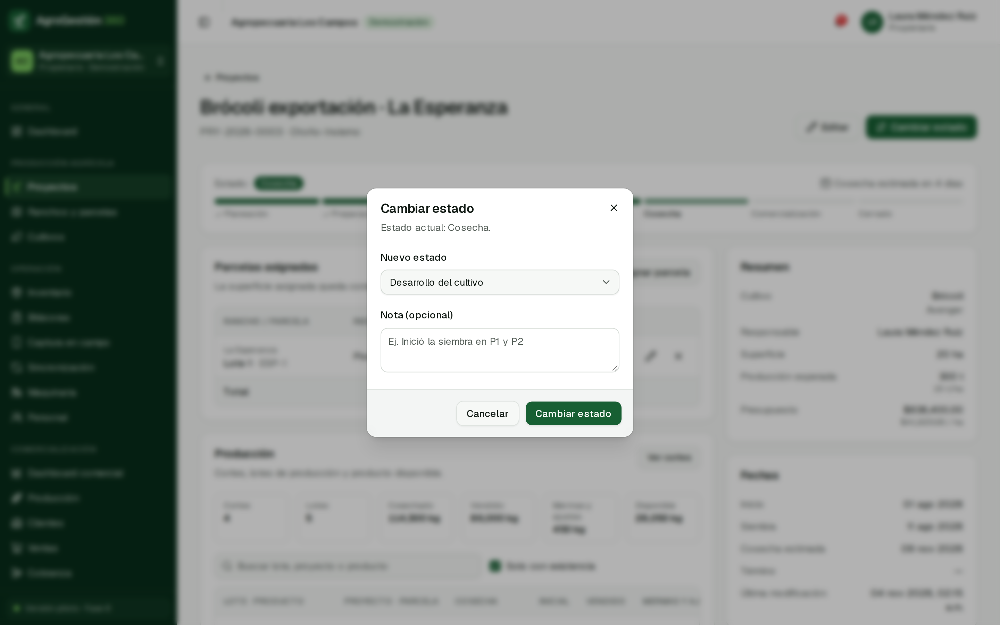

- **Datos generales:** en el expediente pulsa **Editar**, cambia lo necesario y pulsa **Guardar cambios**. El folio y el
  estado no se editan ahí.
- **Estado:** pulsa **Cambiar estado**, elige el **Nuevo estado**, agrega una **Nota (opcional)** y confirma. Las etapas
  son **Planeación → Preparación de suelo → Siembra → Desarrollo del cultivo → Cosecha → Comercialización → Cerrado**.
  - La lista **Nuevo estado** solo ofrece los cambios permitidos desde el estado actual: avanzar a la etapa siguiente
    o regresar a la anterior. Desde **Planeación** se puede pasar directo a **Siembra**, y desde **Cosecha** directo a
    **Cerrado**.
  - **Cancelar** está disponible hasta la etapa de Cosecha. Exige **Motivo de la cancelación** y libera la superficie.
  - **Cerrar** libera la superficie, registra la fecha de término y congela costos e ingresos.
  - **Reabrir** un proyecto cerrado o cancelado solo lo pueden hacer Propietario o Administrador. Requiere que sus
    parcelas sigan teniendo superficie disponible.
- **Eliminar:** solo proyectos en **Planeación** o **Cancelado** que no tengan registros. Pulsa **Eliminar** y confirma.

> **Importante.** Los cortes de producción solo se registran en proyectos en **Cosecha** o **Comercialización**. Cambia el
> estado antes de registrar el primer corte.

### 5.10 Cómo consultar el historial

- **Historial de estados** del expediente: quién cambió el estado, cuándo y con qué nota o motivo.
- **Bitácoras → Cronología**: todo lo registrado en el proyecto en orden de fecha (sección 8.5).
- **Detalle de costos**: el origen de cada peso cargado al proyecto.
- En **Proyectos**, el filtro de estado permite ver **Vigentes** o **Todos los estados**, incluidos cerrados y
  cancelados.

---

## 6. Administración de ranchos y parcelas

Un **rancho** es un predio de la empresa. Una **parcela** es una fracción del rancho que se asigna a proyectos.

**Quién puede:** Propietario, Administrador y Agrónomo registran y editan. Solo Propietario y Administrador eliminan.

### 6.1 Cómo registrar un rancho

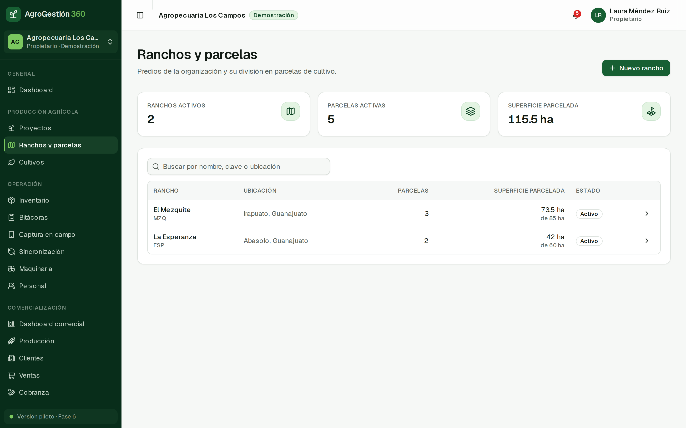

1. Ve a **Producción agrícola → Ranchos y parcelas** y pulsa **Nuevo rancho**.
2. Captura:
   - **Nombre**: «Rancho Los Campos».
   - **Clave** (opcional, por ejemplo RLC-01).
   - **Superficie total (ha)**: 12.
   - **Municipio** y **Estado**.
   - **Ubicación o referencia**.
   - **Latitud** y **Longitud** (opcionales).
   - **Notas**.
3. Pulsa **Registrar rancho**.

### 6.2 Cómo crear parcelas

1. Abre el rancho (ícono **Ver…** o su nombre) y pulsa **Nueva parcela**.
2. Captura:
   - **Rancho**.
   - **Nombre**: «Parcela Norte».
   - **Clave**.
   - **Superficie (ha)**: 5.
   - **Sistema de riego**: Temporal, Goteo, Aspersión, Microaspersión, Gravedad, Pivote central u Otro.
   - **Tipo de suelo**.
   - **Notas**.
3. Pulsa **Registrar parcela**.

La suma de las parcelas no puede exceder la superficie del rancho. Si se excede, verás «La superficie de las parcelas
(… ha) excede la del rancho (… ha). Disponible: … ha».

### 6.3 Cómo asignar cultivos

En AgroGestión 360 la parcela no guarda un cultivo propio: el cultivo se asigna mediante un **proyecto**. Para sembrar
jitomate en la Parcela Norte:
1. Crea un proyecto con el cultivo «Jitomate · Saladette» (5.1).
2. Asígnale la parcela (5.3).

La columna **Proyectos vigentes** de la tabla de parcelas muestra qué proyectos ocupan cada parcela.

### 6.4 Cómo consultar la superficie

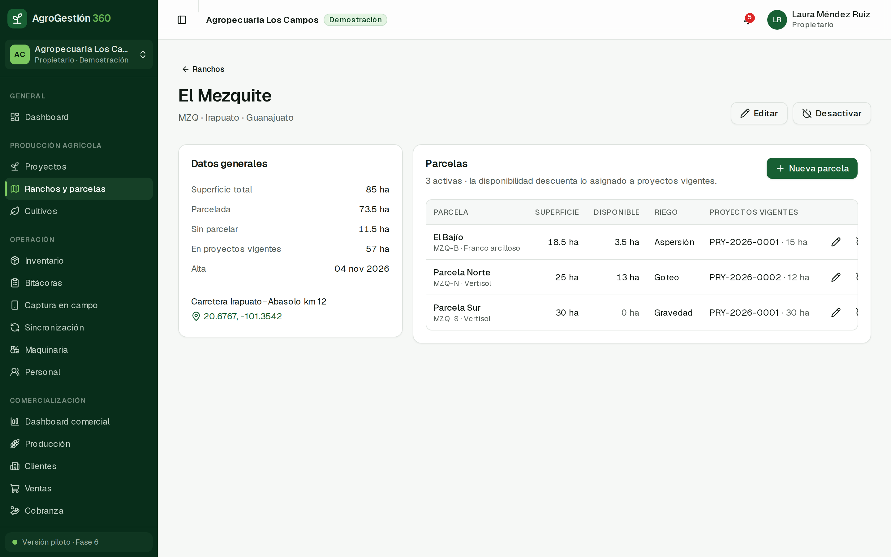

- **En el listado de ranchos:** indicadores **Ranchos activos**, **Parcelas activas** y **Superficie parcelada**. Cada
  rancho muestra sus parcelas y su superficie parcelada.
- **En el detalle del rancho**, en **Datos generales:**
  - **Superficie total**.
  - **Parcelada**.
  - **Sin parcelar**.
  - **En proyectos vigentes**.
- **En la tabla de parcelas:** **Superficie** y **Disponible** de cada parcela. Disponible es lo que no está asignado a
  proyectos vigentes.

### 6.5 Cómo relacionar parcelas con proyectos

Desde el proyecto, con **Asignar parcela** (5.3). Una parcela puede dividirse entre varios proyectos vigentes mientras la
suma no exceda su superficie.

### 6.6 Cómo consultar información histórica

- La tabla de parcelas del rancho muestra los proyectos vigentes. El historial completo de cada proyecto (incluidos los
  cerrados) se consulta en **Proyectos** con el filtro **Todos los estados**.
- **Desactivar** un rancho o una parcela (botón **Desactivar**) conserva su historial y deja de ofrecerlo para proyectos
  nuevos. Un rancho con parcelas en proyectos vigentes no se puede desactivar.
- **Eliminar** solo funciona con registros sin historial.

> **Limitación.** No hay una vista que liste en una sola pantalla todos los proyectos que ha tenido una parcela a lo largo
> del tiempo. Se consulta por proyecto.

---

## 7. Administración de inventarios

El inventario controla los **insumos**: semillas, fertilizantes, agroquímicos, combustibles y materiales. Se lleva por
almacén y, si se desea, por lote y caducidad. Se valora a **costo promedio ponderado**.

**Quién puede:** Propietario, Administrador y Almacén registran productos, catálogos y movimientos. Los demás roles
solo consultan.

Ve a **Operación → Inventario**. Tiene cuatro pestañas:
- **Existencias**.
- **Por almacén y lote**.
- **Movimientos**.
- **Catálogos**.

Arriba están los indicadores:
- **Valor del inventario**.
- **Productos activos**.
- **Bajo mínimo**.
- **Lotes por caducar**.

### 7.1 Cómo registrar categorías

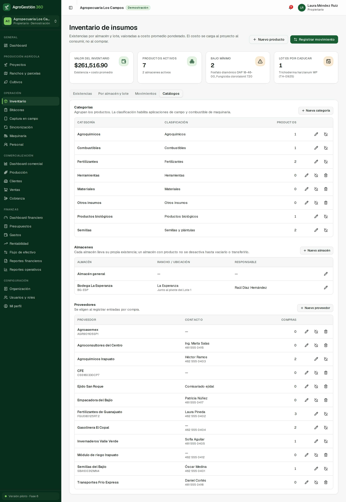

1. Pestaña **Catálogos**, sección **Categorías**: pulsa **Nueva categoría**.
2. Captura:
   - **Nombre**: por ejemplo «Fertilizantes granulados».
   - **Clasificación**: Semillas y plántulas, Fertilizantes, Agroquímicos, Productos biológicos, Combustibles,
     Herramientas, Materiales u Otros insumos.
   - **Descripción**.
3. Pulsa **Registrar categoría**.

La **Clasificación** es importante:
- Solo los productos de categorías **Agroquímicos**, **Productos biológicos** y **Fertilizantes** se ofrecen en las
  aplicaciones de campo.
- Solo los **Combustibles** se ofrecen como combustible de maquinaria.

### 7.2 Cómo dar de alta productos

1. Pulsa **Nuevo producto**.
2. Captura:
   - **Nombre**.
   - **Clave (opcional)**.
   - **Categoría**.
   - **Unidad de medida**: kg, g, l, ml, piezas, sacos, cajas, m o m³.
   - **Existencia mínima**: para la alerta de bajo mínimo.
   - **Controlar por lote y caducidad**.
   - **Notas**.
3. Pulsa **Registrar producto**.

La existencia y el costo no se capturan aquí: se calculan con los movimientos. Ejemplos:

| Producto | Categoría (clasificación) | Unidad | ¿Por lote? |
| -------- | ------------------------- | ------ | ---------- |
| Semilla jitomate Saladette | Semillas y plántulas | piezas (sobres) | Sí |
| Fertilizante 18-46-00 | Fertilizantes | kg | No |
| Insecticida (nombre comercial) | Agroquímicos | l | Sí |
| Diésel | Combustibles | l | No |

La unidad de medida no se puede cambiar si el producto ya tiene movimientos. El control por lote solo se cambia con
existencia en cero.

### 7.3 Cómo registrar proveedores

En **Catálogos → Proveedores**, pulsa **Nuevo proveedor**. Captura:
- **Nombre o razón social**.
- **RFC (opcional)**.
- **Contacto**.
- **Teléfono**.
- **Correo**.
- **Dirección**.
- **Notas**.

Pulsa **Registrar proveedor**. Los proveedores se eligen al registrar compras y gastos.

### 7.4 Cómo configurar almacenes

En **Catálogos → Almacenes**, pulsa **Nuevo almacén**. Captura:
- **Nombre**.
- **Clave (opcional)**.
- **Rancho (opcional)**.
- **Responsable (opcional)**.
- **Ubicación**.
- **Notas**.

Pulsa **Registrar almacén**. Cada organización nueva empieza con un almacén general.

Un almacén con existencias no se puede desactivar: primero transfiere o da de baja su producto.

### 7.5 Cómo registrar entradas (compras)

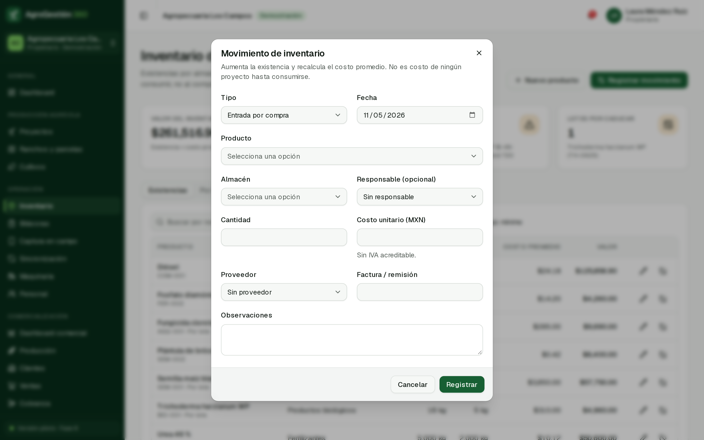

1. Pulsa **Registrar movimiento**. En **Tipo** elige **Entrada por compra**.
2. Captura:
   - **Fecha**.
   - **Producto**.
   - **Almacén**.
   - **Cantidad**.
   - **Costo unitario (MXN)**: sin IVA acreditable.
   - **Proveedor**.
   - **Factura / remisión**.
   - **Observaciones**.
3. Si el producto se controla por lote, captura también el **Lote del fabricante** y la **Caducidad (opcional)**. Si el
   lote ya existe, la cantidad se suma a él.
4. Revisa el **Valor estimado del movimiento** y pulsa **Registrar**.

**Ejemplo:** entrada de 1,000 kg de «Fertilizante 18-46-00» a $18/kg = $18,000, con proveedor «Semillas y Agroinsumos
del Bajío».

Una entrada **aumenta la existencia y recalcula el costo promedio**, pero **no es costo de ningún proyecto** hasta que se
consume.

### 7.6 Cómo registrar salidas

Elige el **Tipo** según el caso:

| Tipo | Uso | ¿Carga costo a un proyecto? |
| ---- | --- | --------------------------- |
| **Salida por consumo** | Producto que se usa en un proyecto | Sí, al costo promedio |
| **Devolución de proyecto** | Regresa al almacén lo que no se aplicó | Descuenta del proyecto el costo con que salió |
| **Ajuste negativo / merma** | Merma, caducidad o faltante en conteo físico | No |
| **Ajuste positivo** | Sobrante en conteo físico | No |

Pasos para un **consumo**:
1. Pulsa **Registrar movimiento** y elige **Salida por consumo**.
2. Elige:
   - **Producto**.
   - **Sale de** (almacén).
   - El **Proyecto** y la **Parcela**, ambos obligatorios.
   - **Lote**, si el producto se controla por lote. La lista se ordena por caducidad, primero el que vence antes.
3. Captura la **Cantidad**. Opcionalmente indica quién **Entrega / recibe**.
4. Pulsa **Registrar**.

**Ejemplo:** consumo de 600 kg de Fertilizante 18-46-00 al proyecto «Producción de jitomate», Parcela Norte. Con un
costo promedio de $18/kg, se cargan **$10,800** al proyecto.

- No se puede sacar más de lo que hay en ese almacén, aunque la existencia total de otros almacenes alcance.
- Un lote caducado no se consume: se debe registrar como merma.
- Las aplicaciones de agroquímicos (8.2) y el combustible de maquinaria (9.4) generan su salida automáticamente; no hace
  falta registrarla aquí.

### 7.7 Cómo realizar transferencias

1. Pulsa **Registrar movimiento** y elige **Transferencia entre almacenes**.
2. Elige **Producto**, **Almacén de origen**, **Almacén destino** y, si aplica, el **Lote**.
3. Captura la **Cantidad** y pulsa **Registrar**.

Una transferencia **no cambia el valor del inventario ni los costos**.

### 7.8 Cómo consultar existencias

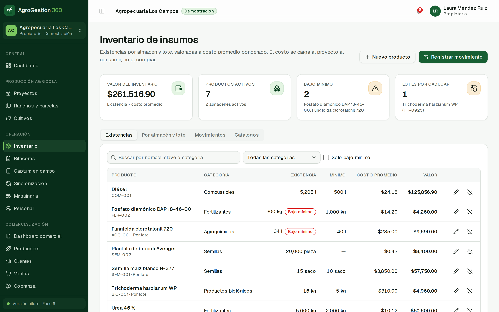
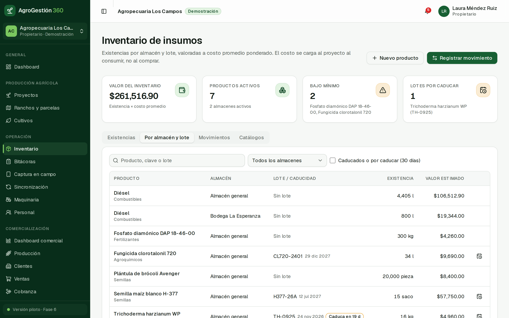

- **Existencias**: cada producto con su existencia total, costo promedio y valor. Se puede buscar por nombre, clave o
  categoría, y filtrar por **Todas las categorías** o **Solo bajo mínimo**.
- **Por almacén y lote**: existencia por almacén y lote, con caducidad («Caduca en N d» o **Caducado**) y **Valor
  estimado**. El lápiz de un lote permite corregir su **Caducidad** o agregar **Notas**; el número de lote no cambia.

### 7.9 Cómo identificar productos con bajo inventario

- Indicador **Bajo mínimo** en la parte superior: muestra cuántos productos y los primeros nombres.
- Etiqueta **Bajo mínimo** en la tabla de existencias, y la casilla **Solo bajo mínimo** para ver solo esos productos.
- Alerta en la campana de **Notificaciones**.
- Indicador **Lotes por caducar**: lotes que vencen en 30 días o ya vencidos.

Para que funcione, el producto debe tener capturada su **Existencia mínima**.

### 7.10 Cómo consultar movimientos históricos

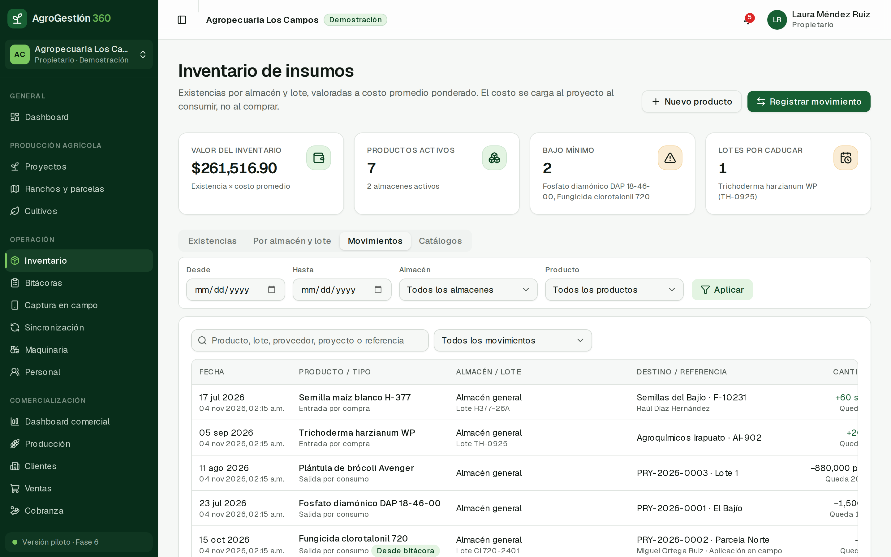

1. En la pestaña **Movimientos**, usa los filtros **Desde**, **Hasta**, **Almacén** y **Producto** y pulsa **Aplicar**.
2. Busca por producto, lote, proveedor, proyecto o referencia, y filtra por tipo (**Todos los movimientos** o uno en
   particular).

Etiquetas que pueden aparecer:
- **Desde bitácora**: salida generada por una aplicación o por combustible.
- **Anulación**.
- **Anulado**.

**Anular un movimiento erróneo:**
1. Pulsa el botón **Anular movimiento** (flecha circular) en la fila del movimiento.
2. Escribe el **Motivo** (mínimo 5 caracteres) y pulsa **Anular**.
3. Aparece «Movimiento anulado con su contrapartida.». Se registra la contrapartida exacta (por ejemplo, un consumo se
   anula con una «Devolución de proyecto» marcada **Anulación**) y el original queda **Anulado**. Ambos movimientos
   quedan en el historial y, si era un consumo, el proyecto muestra el importe en negativo.
4. Un movimiento solo puede anularse una vez: después ya no se ofrece el botón.

### 7.11 Relación entre el consumo de insumos y el costo del proyecto

```
Compra (entrada) ──► Almacén (existencia y costo promedio)        ← todavía NO es costo de proyecto
                         │
       Consumo / aplicación / combustible ──► Costo del proyecto y parcela (al costo promedio)
                         │
       Devolución ──► se resta del costo del proyecto
```

- El costo entra al proyecto **solo cuando el producto se consume**.
- Comprar mucho no encarece un proyecto; lo que se queda en almacén sigue siendo inventario.
- Los consumos aparecen en el **Detalle de costos** del proyecto, como origen **Inventario**, y en el reporte **Consumo
  de insumos**.
- Pagar al proveedor es un **egreso** de dinero (Flujo de efectivo), no un costo adicional.

---

## 8. Bitácoras agrícolas

Ve a **Operación → Bitácoras**. Las pestañas son:
- **Riego**.
- **Aplicaciones**.
- **Actividades**.
- **Observaciones**.
- **Cronología**.
- **Catálogo de actividades**.

Arriba están los botones para registrar (**Riego**, **Aplicación**, **Observación**, que abre Captura en campo, y **Actividad**) y los indicadores **Riegos**, **Agua
registrada**, **Aplicaciones** y **Actividades**.

**Quién puede:** Propietario, Administrador, Agrónomo y Supervisor de campo registran. Los demás solo consultan.

> **Sin recomendaciones agronómicas.** AgroGestión 360 registra lo que se hizo en campo. **No recomienda dosis ni
> tratamientos.** Sigue la etiqueta del producto y la indicación del agrónomo responsable.

### 8.1 Bitácora de riego

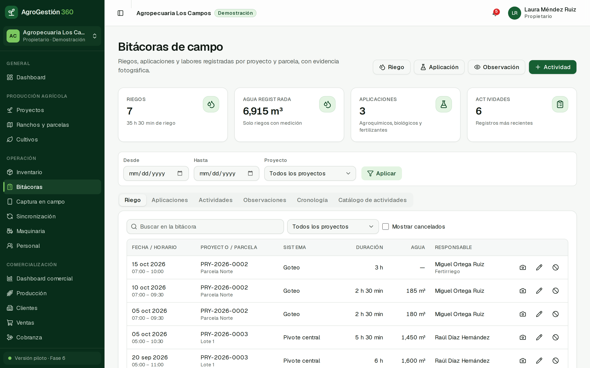
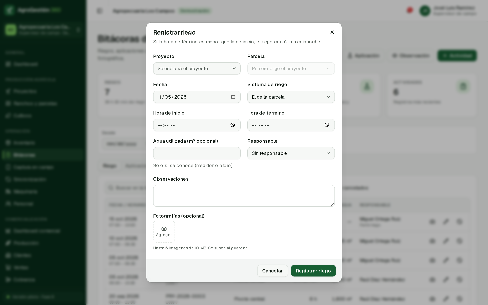

1. Pulsa **Riego**. Se abre **Registrar riego**.
2. Captura:

   | Dato | Campo |
   | ---- | ----- |
   | Proyecto | **Proyecto** |
   | Parcela | **Parcela** (obligatoria) |
   | Fecha | **Fecha** (no puede ser futura) |
   | Horario | **Hora de inicio** y **Hora de término** |
   | Sistema de riego | **Sistema de riego**: «El de la parcela» o uno distinto |
   | Cantidad de agua | **Agua utilizada (m³, opcional)**: solo si se conoce por medidor o aforo |
   | Responsable | **Responsable**: empleado o «Sin responsable» |
   | Observaciones | **Observaciones** |
   | Evidencia | **Fotografías (opcional)** → **Agregar** (hasta 6 imágenes de 10 MB) |

3. Pulsa **Registrar riego**.

La duración se calcula sola. Si la hora de término es menor que la de inicio, el riego cruzó la medianoche: un riego de
22:00 a 02:00 dura 4 h.

Para corregir, usa **Editar riego**. El proyecto y la parcela no cambian; si fueron incorrectos, cancela el riego y
regístralo de nuevo. **Cancelar registro** pide un motivo y deja el riego en el historial como cancelado.

### 8.2 Bitácora de aplicaciones de agroquímicos

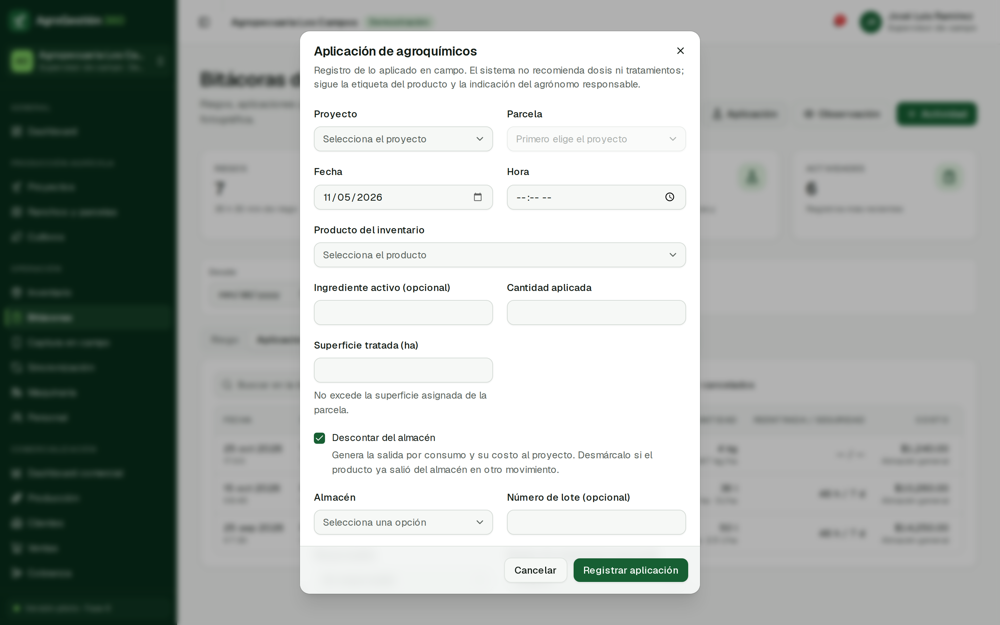

1. Pulsa **Aplicación**. Se abre **Aplicación de agroquímicos**.
2. Captura:

   | Dato | Campo |
   | ---- | ----- |
   | Producto | **Producto del inventario**: solo agroquímicos, biológicos y fertilizantes activos. **Ingrediente activo (opcional)** |
   | Cantidad aplicada | **Cantidad aplicada** (en la unidad del producto) |
   | Parcela | **Proyecto** y **Parcela** (obligatoria) |
   | Superficie | **Superficie tratada (ha)**: no puede exceder lo asignado a la parcela |
   | Fecha | **Fecha** y **Hora** |
   | Responsable | **Responsable** |
   | Equipo | **Equipo de maquinaria (opcional)** y/o **Equipo utilizado** (texto libre, por ejemplo «Mochila manual 20 l») |
   | Datos de etiqueta | **Reentrada (horas)** e **Intervalo de seguridad (días)**, si están documentados |
   | Observaciones | **Observaciones** |
   | Evidencia fotográfica | **Fotografías (opcional)** → **Agregar** |

3. **Descontar del almacén:** si lo marcas, elige **Almacén** y **Lote del producto**. Se genera la salida por consumo y
   su costo se carga al proyecto. Desmárcalo si el producto ya salió del almacén con otro movimiento; en ese caso puedes
   anotar el **Número de lote (opcional)**.
4. Pulsa **Registrar aplicación**.

**Ejemplo:** 8 l de insecticida en 5 ha de la Parcela Norte, con descuento del almacén. Se carga el costo del insecticida
al proyecto.

- **Editar aplicación** solo cambia hora, superficie, ingrediente, responsable, equipo, reentrada, intervalo y
  observaciones. Para cambiar producto, cantidad, fecha o parcela, cancela la aplicación y regístrala de nuevo.
- Al **cancelar** una aplicación con descuento, el producto regresa al almacén (al mismo lote) y su costo sale del
  proyecto.
- **Fotografías posteriores:** en la tabla, pulsa el ícono de cámara (**Evidencias**) → **Agregar fotografías**. Se
  aceptan imágenes JPG, PNG, WEBP o HEIC de hasta 10 MB.

### 8.3 Bitácora de actividades agrícolas

1. Pulsa **Actividad**. Se abre **Registrar actividad**.
2. Captura:
   - **Proyecto**.
   - **Parcela (opcional)**: o «Todo el proyecto».
   - **Actividad**: del catálogo.
   - **Fecha**.
   - **Descripción**: por ejemplo «Poda de formación».
   - **Responsable**.
   - **Costo adicional (MXN, opcional)**.
   - **Observaciones**.
3. Pulsa **Registrar actividad**.

El **Costo adicional** es solo para lo que no se registra en otro módulo, por ejemplo un servicio contratado. Se suma al
costo del proyecto. Jornales, maquinaria e insumos se registran en sus propios módulos para no duplicar el costo.

**Catálogo de actividades** (pestaña del mismo nombre):
1. Pulsa **Nueva actividad**.
2. Captura **Nombre** (por ejemplo «Tutoreo»), **Descripción** y **Categoría presupuestal**.
3. Pulsa **Agregar al catálogo**.

El catálogo se usa también en mano de obra y maquinaria.

### 8.4 Observaciones de campo

La pestaña **Observaciones** muestra las observaciones registradas (plagas, enfermedades, clima, etc.) con **Severidad**
Baja, Media o Alta.

> **Limitación.** En **Bitácoras** las observaciones **solo se consultan**. El botón **Observación** de la parte superior
> abre **Captura en campo** (8.6), que es donde se registran, con o sin conexión.

### 8.5 Cómo consultar el historial

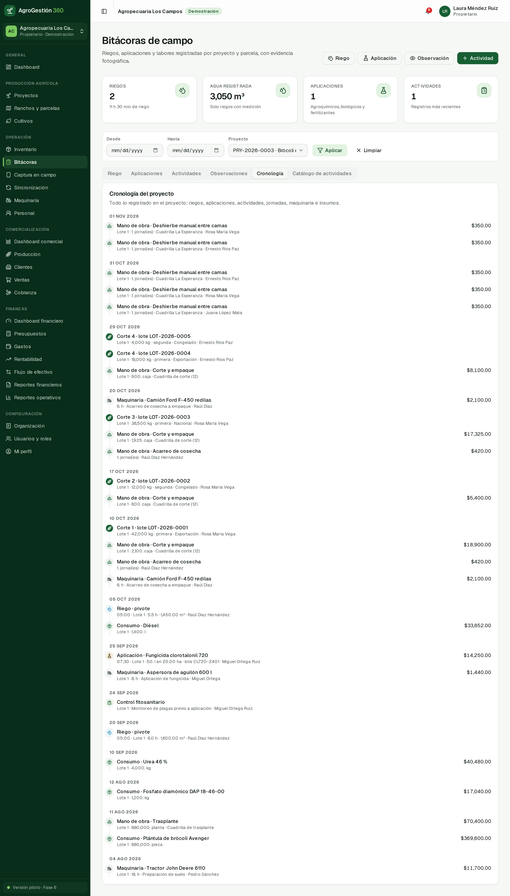

- Cada pestaña muestra su tabla con buscador («Buscar en la bitácora»), filtro de proyecto y la casilla **Mostrar
  cancelados**.
- Usa **Desde**, **Hasta** y **Proyecto** en la barra de filtros y pulsa **Aplicar**.
- **Cronología**: elige un proyecto en los filtros para ver todo lo registrado en él en orden de fecha (riegos,
  aplicaciones, actividades, jornadas, maquinaria, insumos y cortes). Los importes solo los ven los roles con acceso a
  finanzas.

> **Limitación.** Las observaciones todavía no aparecen en la Cronología.

### 8.6 Captura en campo (con o sin conexión)

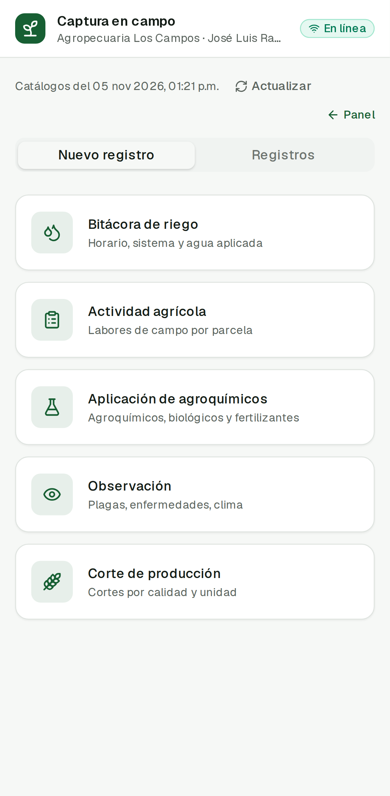
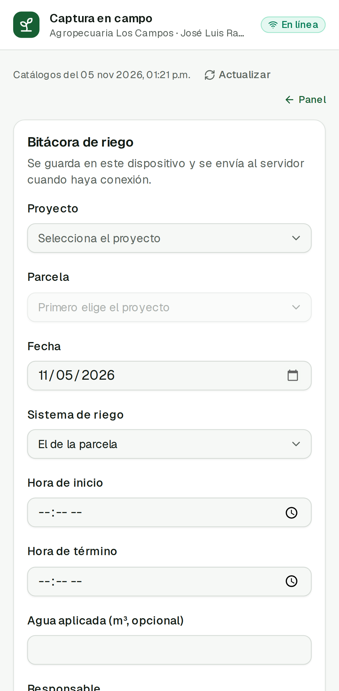
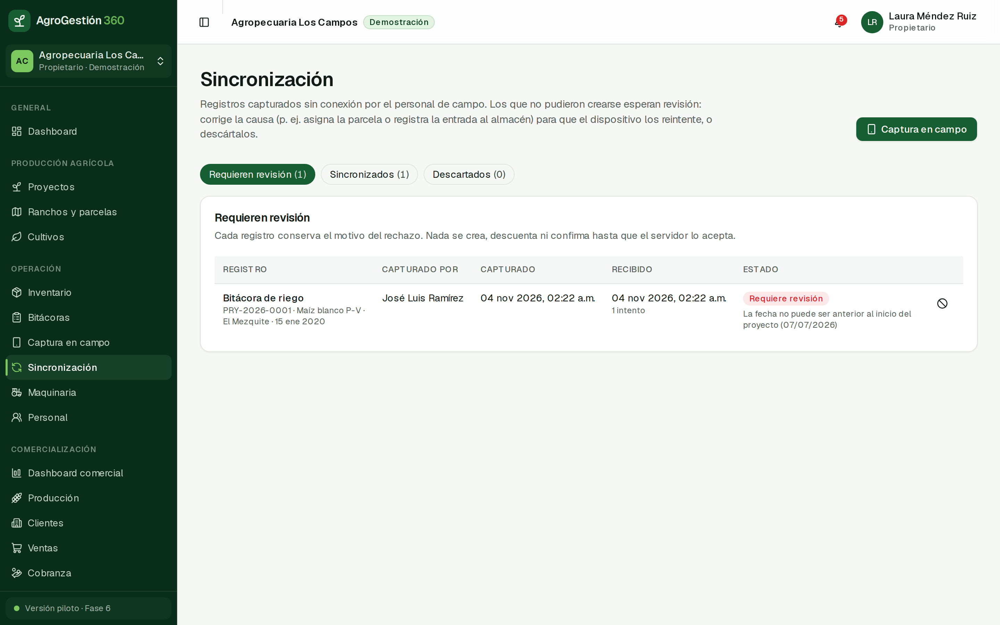

Ve a **Operación → Captura en campo**. Esta pantalla está pensada para el teléfono.

1. La primera vez, ábrela con conexión. Se descargan proyectos, parcelas y catálogos. Usa **Actualizar** para volver a
   descargarlos.
2. En **Nuevo registro** elige el tipo:
   - **Bitácora de riego**: horario, sistema y agua aplicada.
   - **Actividad agrícola**: labores de campo por parcela.
   - **Aplicación de agroquímicos**: agroquímicos, biológicos y fertilizantes.
   - **Observación**: plagas, enfermedades, clima.
   - **Corte de producción**: cortes por calidad y unidad.
3. Llena el formulario y pulsa **Guardar riego**, **Guardar actividad**, **Guardar aplicación**, **Guardar observación** o
   **Guardar corte**.
   - Con señal verás «Guardado. Enviando al servidor…».
   - Sin señal verás «Guardado en el dispositivo. Se enviará cuando haya señal.».
4. En la observación puedes pulsar **Usar mi ubicación** para llenar **Latitud** y **Longitud**.

La pestaña **Registros** muestra cada captura con su estado:

| Estado | Significado | Qué hacer |
| ------ | ----------- | --------- |
| **Pendiente** | Guardado en el teléfono, sin enviar | Esperar señal o pulsar **Sincronizar** |
| **Sincronizando** | Enviándose | Esperar |
| **Sincronizado** | Ya está en el servidor y aparece en Bitácoras o Producción | Nada. **Limpiar sincronizados** lo retira de la lista |
| **Error** | No se pudo enviar (por ejemplo, sesión vencida) | **Reintentar** |
| **Requiere revisión** | El servidor lo rechazó por una regla (por ejemplo, no alcanza la existencia o el proyecto no está en cosecha); no se aplicó nada | **Corregir** y luego **Reintentar**, o pedir a un revisor que lo atienda |
| **Descartado** | Un revisor lo descartó, con motivo | Eliminarlo del dispositivo |

La sincronización es automática al recuperar la señal y nunca duplica registros.

**Sincronización (revisión):** en **Operación → Sincronización**, los roles Propietario, Administrador y Agrónomo ven los
registros de todo el equipo en las pestañas **Requieren revisión**, **Sincronizados** y **Descartados**, con el motivo
del rechazo. Pueden:
- Corregir la causa, por ejemplo asignar la parcela o registrar la entrada al almacén, para que el siguiente reintento
  funcione.
- Pulsar **Descartar registro**, que exige un motivo.

Los demás roles ven en esa pantalla solo sus propios registros.

---

## 9. Administración de maquinaria

Ve a **Operación → Maquinaria**. Las pestañas son:
- **Uso por proyecto**.
- **Equipos**.
- **Mantenimiento**.

Los indicadores son:
- **Equipos operativos**.
- **Horas del mes**.
- **Costo cargado del mes**.
- **Alertas de mantenimiento**.

**Quién puede:** Propietario, Administrador y Agrónomo. Los demás solo consultan.

### 9.1 Cómo registrar maquinaria

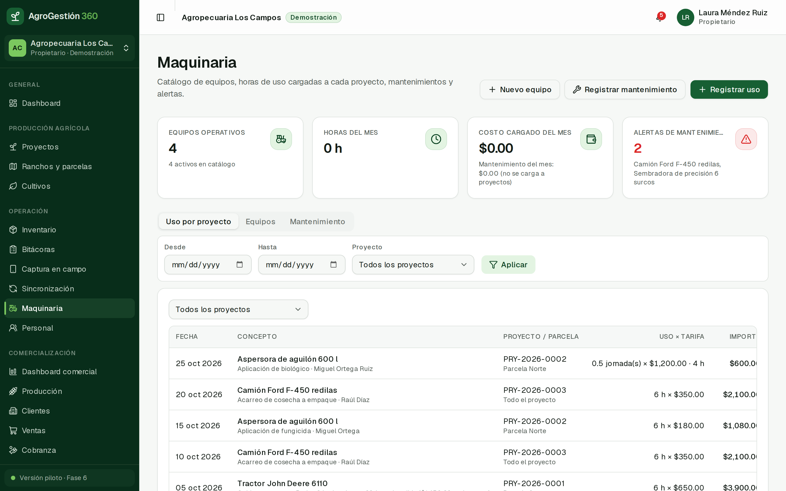

1. Pulsa **Nuevo equipo**.
2. Captura los datos del equipo:
   - **Nombre**: «Tractor John Deere 5075E».
   - **Tipo**: Tractor, Cosechadora, Aspersora / fumigadora, Implemento, Vehículo, Bomba / equipo de riego u Otro.
   - **Clave / económico**, **Marca**, **Modelo** y **Número de serie / identificación**.
   - **Estado**: Operativa, En mantenimiento, Fuera de servicio o Dada de baja.
   - **Fecha de adquisición** y **Costo de adquisición (MXN)**.
3. En **Tarifas de uso** captura:
   - **Cobro habitual**: Por hora o Por jornada.
   - **Tarifa por hora (MXN)**: por ejemplo $650.
   - **Tarifa por jornada**.
4. En **Programa de mantenimiento** captura **Cada cuántas horas** y/o **Cada cuántos días**.
5. Pulsa **Registrar equipo**.

Las tarifas incluyen operador, depreciación y mantenimiento. No incluyen el combustible si se surte del almacén.

Para cambiar el estado sin abrir el formulario, usa el menú **Estado del equipo** de la tabla. Un equipo fuera de
servicio no registra uso.

### 9.2 Cómo asignar responsables

En el formulario del equipo, campo **Responsable**: elige a un empleado de **Personal**. El **Operador** se indica en
cada registro de uso (9.3).

### 9.3 Cómo registrar horas de trabajo y asignar el equipo a un proyecto

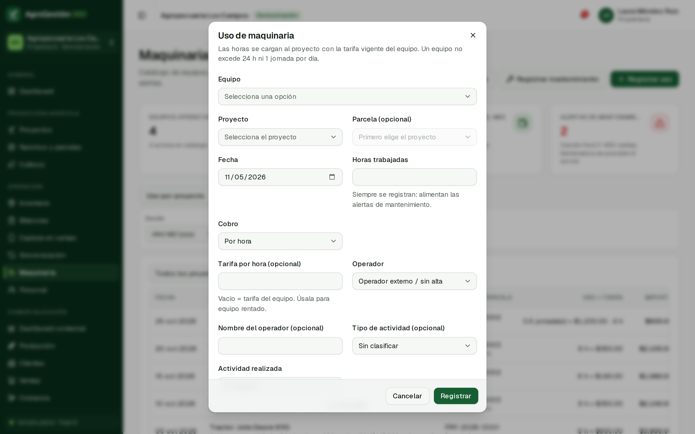

El uso de un equipo se asigna a un proyecto en cada registro:
1. Pulsa **Registrar uso**. Se abre **Uso de maquinaria**.
2. Elige:
   - **Equipo**: muestra su tarifa.
   - **Proyecto** y **Parcela**.
   - **Fecha**.
3. Captura las **Horas trabajadas**. Siempre se registran, porque alimentan las alertas de mantenimiento.
4. En **Cobro** elige Por hora o Por jornada. Por jornada pide **Jornadas** (1 = jornada completa; 0.5 = media).
5. La **Tarifa** es opcional: vacío = tarifa del equipo. Úsala para equipo rentado.
6. Elige el **Operador** (empleado, o «Operador externo / sin alta» con su nombre) y captura la **Actividad realizada**
   (por ejemplo «Rastreo»).
7. Pulsa **Registrar**.

**Ejemplo:** 6 h × $650 = **$3,900** cargados al proyecto «Producción de jitomate».

- La tarifa queda congelada en el registro: cambiar después la tarifa del equipo no altera lo ya registrado.
- Un equipo no puede exceder 24 h ni 1 jornada por día.

### 9.4 Cómo registrar combustible

En el mismo formulario **Uso de maquinaria**, sección **Combustible**:
1. Captura **Combustible utilizado (l, opcional)**.
2. Si se tomó del almacén, marca **Surtido del almacén** y elige **Combustible**, **Almacén** y, si aplica, **Lote**.

Se genera la salida de inventario y su costo se carga al proyecto como insumo, por separado de la tarifa del equipo.
**Ejemplo:** 40 l de diésel a $24/l = **$960**.

### 9.5 Cómo registrar mantenimiento

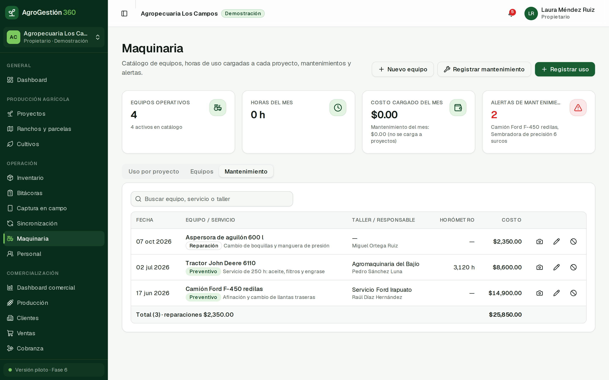

1. Pestaña **Mantenimiento** → **Registrar mantenimiento**. Se abre **Mantenimiento o reparación**.
2. Captura:
   - **Equipo**.
   - **Tipo**: Mantenimiento preventivo o Reparación (correctivo).
   - **Fecha**.
   - **Horómetro (opcional)**.
   - **Descripción**.
   - **Taller / proveedor**.
   - **Costo (MXN)**.
   - **Responsable**.
   - **Observaciones**.
3. Pulsa **Registrar**.

- El mantenimiento **no se carga a proyectos**, porque la tarifa de uso ya lo considera.
- Un preventivo reinicia la alerta de horas.
- Las alertas aparecen como **Mantenimiento vencido** o **Mantenimiento próximo**:
  - Por horas, al 90 % del intervalo.
  - Por días, 7 días antes.

### 9.6 Cómo consultar los costos de utilización

- **Uso por proyecto**: cada uso con **Uso × tarifa** e importe, filtrable por **Desde**, **Hasta** y **Proyecto**.
- Indicador **Costo cargado del mes**.
- **Reportes operativos → Maquinaria** (Utilización de maquinaria): horas, jornadas, importe cargado a proyectos,
  combustible, costo del combustible, mantenimiento y reparaciones.
- Expediente del proyecto: **Detalle de costos** (origen **Maquinaria**) y **Horas de maquinaria** en **Operación**.

---

## 10. Administración de recursos humanos

Ve a **Operación → Personal** («Personal y mano de obra»). Las pestañas son:
- **Jornadas**.
- **Asistencia**.
- **Cuadrillas**.
- **Asignaciones**.
- **Empleados**.

Los indicadores son:
- **Empleados activos**.
- **Jornales**.
- **Costo de mano de obra**.
- **Faltas**.

> Este módulo calcula el costo de la mano de obra para los proyectos. **No es nómina fiscal.**

**Quién puede:**

| Acción | Roles |
| ------ | ----- |
| Registrar empleados, cuadrillas y asignaciones | Propietario, Administrador y Agrónomo |
| Registrar jornadas y asistencia | Los anteriores y el Supervisor de campo |

### 10.1 Cómo registrar empleados

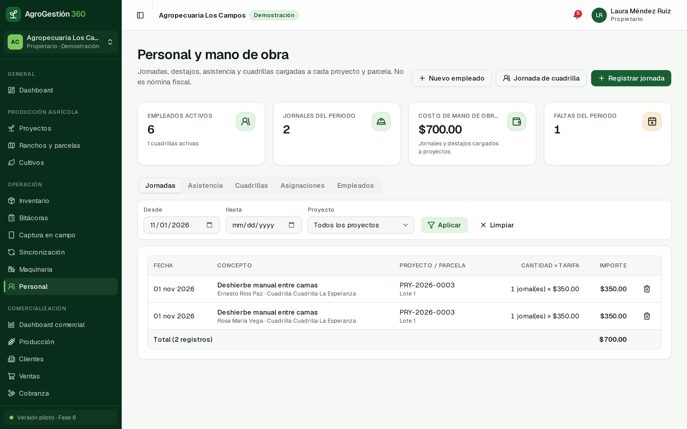

1. Pestaña **Empleados** → **Nuevo empleado**.
2. Captura:
   - **Nombre completo**.
   - **Puesto** (por ejemplo «Jornalero, tractorista»).
   - **Tipo de trabajador**: De planta, Eventual, Temporal (por ciclo) o Destajista.
   - **Teléfono**.
   - **Fecha de ingreso**.
   - **Tarifa por jornal (MXN)**: costo de un día de trabajo para los proyectos.
   - **Observaciones**.
3. Pulsa **Registrar empleado**.

**Dar de baja** conserva el historial del empleado. El botón **Eliminar** solo aparece en empleados sin registros.

### 10.2 Cómo asignar trabajadores

1. Pestaña **Asignaciones** → **Asignar a proyecto**. Se abre **Asignar trabajador a proyecto**.
2. Elige:
   - **Trabajador**.
   - **Proyecto**.
   - **Parcela (opcional)**: o «Todo el proyecto».
   - **Cuadrilla (opcional)**.
3. Captura **Función** (por ejemplo «Aplicador»), **Desde**, **Hasta (opcional)** y **Observaciones**.
4. Pulsa **Asignar**.

La asignación es planeación: **no genera costo**. El costo nace de las jornadas registradas.

### 10.3 Cómo registrar asistencia

1. Pestaña **Asistencia** → **Registrar asistencia**.
2. Elige **Empleado** y **Fecha**.
3. Elige el **Estado**: Presente, Falta, Permiso, Incapacidad o Descanso.
4. Captura **Entrada (opcional)**, **Salida (opcional)** y **Observaciones**.
5. Pulsa **Registrar**.

- Registrar un jornal marca automáticamente la asistencia.
- Una falta o permiso impide cargar trabajo ese día.
- No se puede marcar falta a quien ya trabajó ese día.

### 10.4 Cómo registrar jornadas

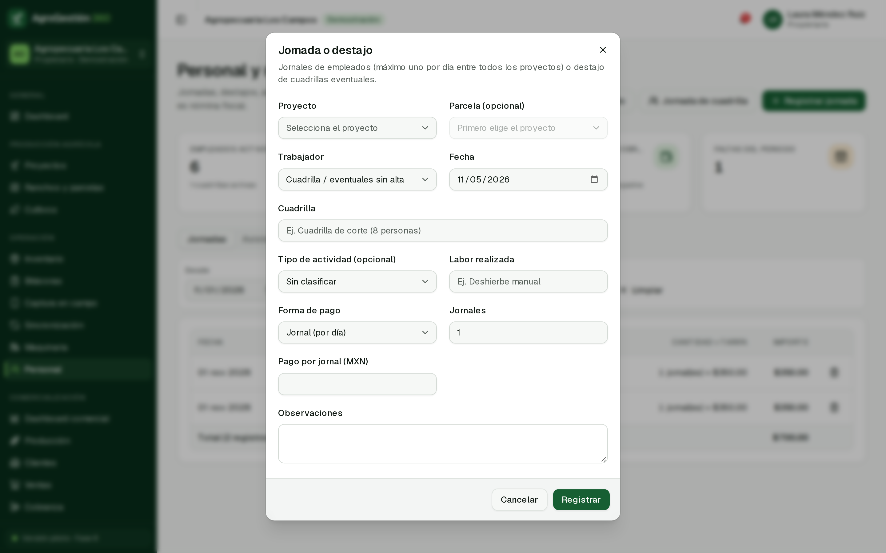

**Individual:**
1. Pestaña **Jornadas** → **Registrar jornada**. Se abre **Jornada o destajo**.
2. Elige:
   - **Trabajador**: empleado, o «Cuadrilla / eventuales sin alta».
   - **Proyecto** y **Parcela**.
   - **Fecha**.
   - **Tipo de actividad (opcional)**.
3. Captura **Labor realizada**.
4. En **Forma de pago** elige **Jornal (por día)**. Captura **Jornales** (1 = día completo; 0.5 = medio día) y **Pago por
   jornal** (vacío = tarifa diaria del empleado).
5. Pulsa **Registrar**.

**Por cuadrilla:**
1. Pulsa **Jornada de cuadrilla** y elige la **Cuadrilla**.
2. Captura **Fecha**, **Labor realizada**, **Forma de pago** y **Jornales por integrante**.
3. Marca los **Integrantes que trabajaron**.
4. Pulsa **Registrar jornadas**. Se crea un registro por integrante en una sola operación.

Reglas:
- Un empleado no puede tener más de 1 jornal por día, sumando todos los proyectos.
- Si un integrante tiene falta o ya tiene jornal ese día, la jornada de cuadrilla se rechaza.

**Cuadrillas:**
1. Pestaña **Cuadrillas** → **Nueva cuadrilla**.
2. Captura **Nombre**, **Jefe de cuadrilla (opcional)**, **Integrantes** y **Observaciones**.
3. Pulsa **Registrar cuadrilla**.

### 10.5 Cómo asignar actividades

Cada jornada registra la **Labor realizada** y, opcionalmente, el **Tipo de actividad** del catálogo de Bitácoras. Si
eliges un tipo, la labor se llena con su nombre. Para planear qué hará cada persona en un proyecto, usa la **Función**
de la asignación (10.2).

### 10.6 Cómo registrar trabajos por destajo

En **Jornada o destajo** (o **Jornada de cuadrilla**):
1. En **Forma de pago** elige **Destajo (por unidad)**.
2. Captura las **Unidades** y la **Unidad** (por ejemplo «caja», «surco», «ha»).
3. Captura el **Pago por unidad (MXN)**.
4. Pulsa **Registrar**.

**Ejemplo:** destajo de 300 cajas × $12 = **$3,600** cargados al proyecto.

### 10.7 Cómo consultar los costos de mano de obra

- Pestaña **Jornadas**: cada registro con **Cantidad × tarifa** e importe. Filtra por **Desde**, **Hasta** y **Proyecto**.
- Indicador **Costo de mano de obra** del periodo.
- **Reportes operativos**:
  - **Jornadas**: días, jornales y destajos por trabajador.
  - **Mano de obra**: costo por proyecto y actividad.
- Expediente del proyecto: **Detalle de costos** (origen **Mano de obra**).

Cada registro conserva la tarifa con la que se capturó. Si después cambias la tarifa del empleado, lo ya registrado no
cambia.

---

## 11. Cortes de producción y cosechas

Ve a **Comercialización → Producción**. Las pestañas son:
- **Indicadores**.
- **Cortes**.
- **Inventario de producto**.
- **Movimientos**.

**Quién puede:**

| Acción | Roles |
| ------ | ----- |
| Registrar cortes | Propietario, Administrador, Agrónomo y Supervisor de campo |
| Registrar mermas | Los anteriores y Almacén |

### 11.1 Cómo registrar un corte

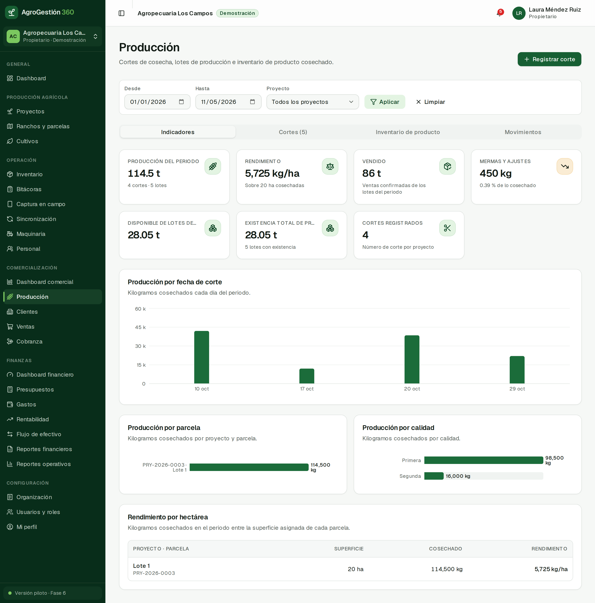
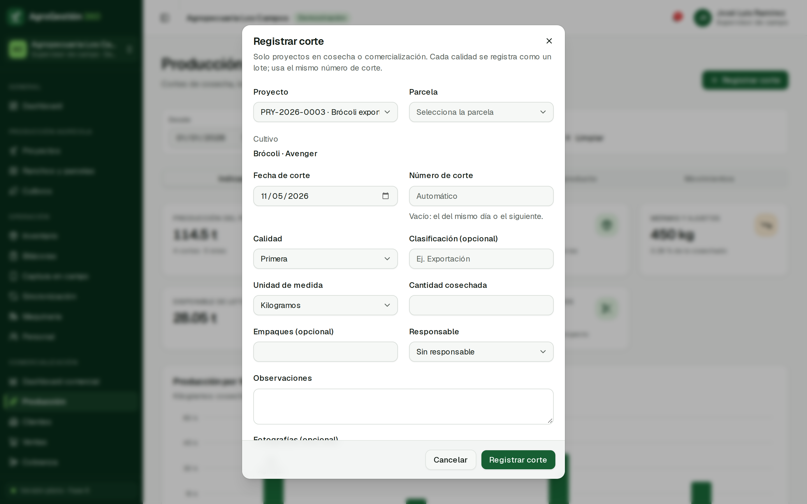

> El proyecto debe estar en **Cosecha** o **Comercialización**. Si no hay proyectos en esos estados, el botón **Registrar
> corte** aparece desactivado con el aviso «No hay proyectos en cosecha o comercialización».

1. Pulsa **Registrar corte**.
2. Elige el proyecto (ver 11.2) y la parcela (ver 11.3).
3. Captura **Fecha de corte**.
4. **Número de corte**: déjalo vacío y se asigna solo, con el del mismo día o el siguiente.
5. Captura la cantidad y la calidad (ver 11.4 y 11.5).
6. Captura **Empaques (opcional)**, **Responsable**, **Observaciones** y **Fotografías (opcional)**.
7. Pulsa **Registrar corte**. Se crea un lote con folio **LOT-AAAA-NNNN**.

El corte también se puede capturar sin conexión desde **Captura en campo** (8.6). En ese caso, el lote se genera al
sincronizar.

### 11.2 Cómo seleccionar el proyecto

En **Proyecto** se ofrecen solo los proyectos en Cosecha o Comercialización. El **Cultivo** se toma del proyecto y no se
captura.

### 11.3 Cómo seleccionar la parcela

En **Parcela** se ofrecen solo las parcelas asignadas al proyecto (por ejemplo «Rancho Los Campos · Parcela Norte»).

### 11.4 Cómo indicar la cantidad cosechada

1. Elige la **Unidad de medida**: Kilogramos, Toneladas, Cajas, Sacos, Arpillas o Rejas.
2. Captura la **Cantidad cosechada**.
3. Si la unidad es cajas, sacos, arpillas o rejas, captura el **Peso neto por unidad (kg)**.

Todo se convierte a kilogramos para los cálculos. Ejemplos:

| Captura | Equivale a |
| ------- | ---------- |
| 500 cajas × 20 kg | 10,000 kg (10 t) |
| 12.5 toneladas | 12,500 kg |
| 7,500 kilogramos | 7,500 kg (7.5 t) |

### 11.5 Cómo clasificar la calidad

- **Calidad**: Primera, Segunda, Tercera / rezaga o Calidad única.
- **Clasificación (opcional)**: texto libre, por ejemplo «Exportación» o «Mercado local».

### 11.6 Cómo registrar lotes

**Cada corte por calidad es un lote.** Si el mismo día se cosechan dos calidades, registra dos cortes con el mismo
**Número de corte**: comparten el número de corte, pero cada uno tiene su propio lote.

**Ejemplo:** corte 3 del jitomate.
- 400 cajas de Primera × 20 kg → LOT-2026-0003 (8,000 kg).
- 100 cajas de Segunda × 20 kg → LOT-2026-0004 (2,000 kg).

Para corregir un corte, usa **Corregir corte**:
- Si el lote ya tiene ventas o ajustes, solo se corrigen cantidad, clasificación, responsable y notas. La cantidad no
  puede quedar por debajo de lo vendido.
- Un lote con ventas no se elimina.

### 11.7 Cómo consultar la producción acumulada

En la pestaña **Indicadores**, con los filtros **Desde**, **Hasta** y **Proyecto**:
- **Producción del periodo**.
- **Rendimiento**: kg/ha sobre las hectáreas cosechadas.
- **Vendido**.
- **Mermas y ajustes**.
- **Disponible de lotes del periodo**.
- **Existencia total de producto**.
- **Cortes registrados**.

Gráficas: **Producción por fecha de corte**, **Producción por parcela**, **Producción por calidad** y **Rendimiento por
hectárea**.

También en el expediente del proyecto (tarjeta **Producción**) y en el **Dashboard comercial**.

### 11.8 Cómo consultar la producción disponible

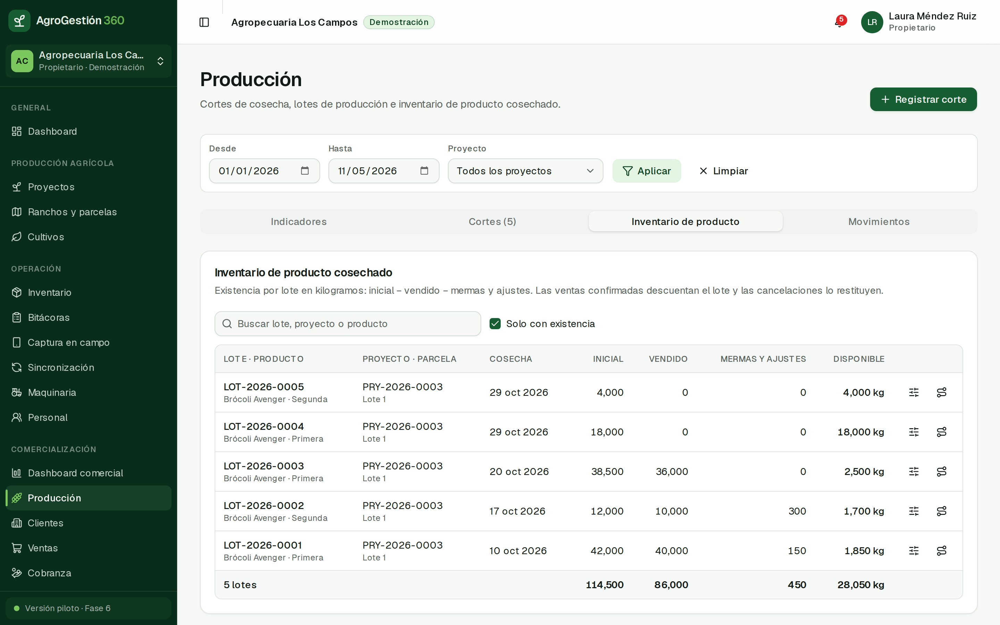

La pestaña **Inventario de producto** muestra la existencia de cada lote en kg:

**Disponible = inicial − vendido − mermas y ajustes**

La casilla **Solo con existencia** oculta los lotes agotados. Las ventas confirmadas descuentan de aquí.

**Ejemplo:** 30,000 kg cosechados − 14,000 kg vendidos − 200 kg de merma = **15,800 kg disponibles**.

### 11.9 Cómo registrar mermas

1. En **Inventario de producto**, pulsa **Merma o ajuste** en el lote.
2. Elige el **Tipo**:

   | Tipo | Uso |
   | ---- | --- |
   | Merma | Deshidratación, selección o rezaga |
   | Pérdida | Daño, descomposición o robo |
   | Ajuste de salida | Conteo físico menor al registrado |
   | Ajuste de entrada | Conteo físico mayor al registrado |

3. Captura **Cantidad (kg)**, **Fecha** y **Justificación**.
4. Pulsa **Registrar**.

La merma no puede exceder lo disponible. Si fue un error, en **Movimientos** pulsa **Revertir movimiento**: se registra
la contrapartida y el original se conserva con la etiqueta **Revertido**.

### 11.10 Cómo consultar el historial

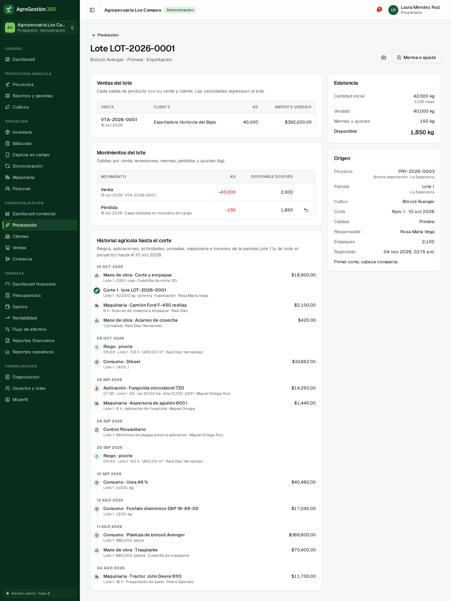

- **Cortes**: todos los cortes con buscador por lote, proyecto, parcela o cultivo.
- **Movimientos**: ventas, reversiones, mermas, pérdidas y ajustes.
- **Trazabilidad del lote**: en el inventario de producto, pulsa el ícono de ruta del lote. Se abre **Lote LOT-…** con:
  - **Existencia**.
  - **Origen**: proyecto, parcela, cultivo, corte, calidad y responsable.
  - **Ventas del lote**, con su cliente.
  - **Movimientos del lote**.
  - **Historial agrícola hasta el corte**: riegos, aplicaciones y labores de esa parcela.

---

## 12. Administración de clientes y ventas

**Quién puede:**

| Acción | Roles |
| ------ | ----- |
| Registrar clientes, ventas y entregas | Propietario, Administrador y Finanzas y ventas |
| Consultar | Rol Consulta |

Agrónomo, Supervisor y Almacén no tienen acceso a este módulo.

### 12.1 Cómo registrar clientes

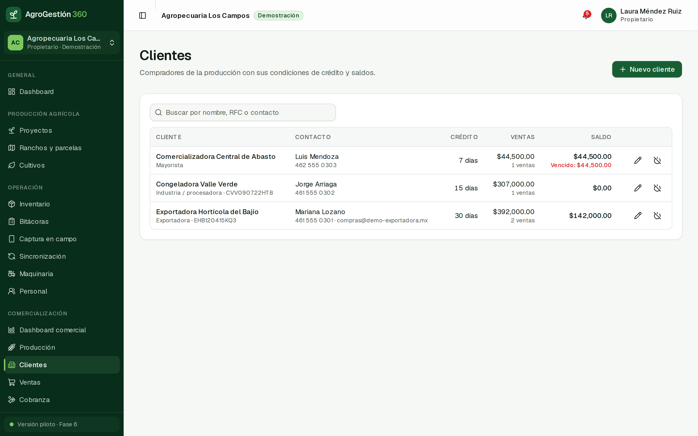

1. Ve a **Comercialización → Clientes** y pulsa **Nuevo cliente**.
2. Captura:
   - **Nombre o razón social**: «Comercializadora del Centro».
   - **Tipo de cliente**: Mayorista, Minorista, Empacadora, Exportadora, Industria / procesadora, Intermediario u Otro.
   - **RFC (cuando corresponda)**.
   - **Días de crédito**.
   - **Contacto**, **Teléfono**, **Correo**, **Dirección** y **Observaciones**.
3. Pulsa **Registrar cliente**.

Los **Días de crédito** definen el vencimiento por omisión de cada venta.

### 12.2 Cómo crear una venta

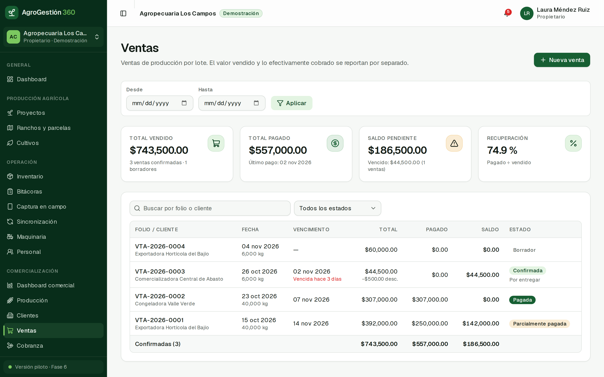
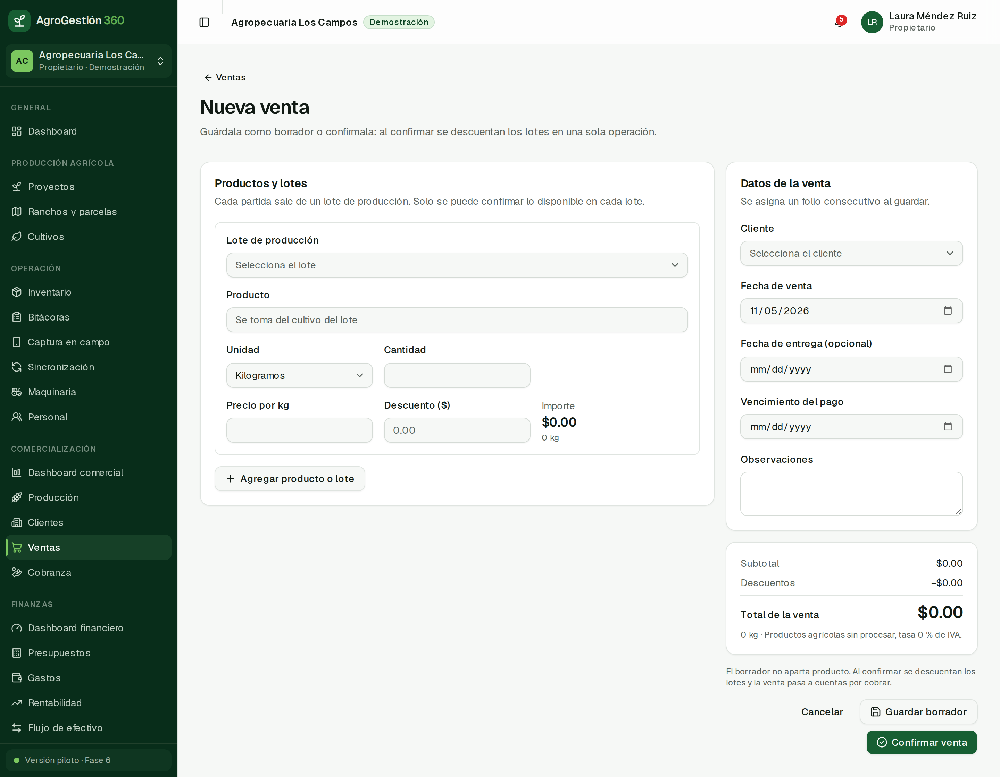

1. Ve a **Comercialización → Ventas** y pulsa **Nueva venta**.
2. En **Datos de la venta** captura:
   - **Cliente**: aparece con sus días de crédito, o «contado».
   - **Fecha de venta**.
   - **Fecha de entrega (opcional)**.
   - **Vencimiento del pago**: vacío = según los días de crédito.
   - **Observaciones**.
3. Agrega las partidas (12.3 a 12.6).
4. Elige **Guardar borrador** o **Confirmar venta** (12.7).

La venta recibe un folio consecutivo **VTA-AAAA-NNNN** al guardarse. Si no hay producto disponible o no hay clientes,
la pantalla lo indica con un enlace a **Producción** o **Clientes**.

### 12.3 Cómo agregar productos

En **Productos y lotes**, pulsa **Agregar partida** por cada producto. Se pueden combinar lotes de distintos proyectos,
calidades o cultivos en la misma venta. El máximo es de 50 partidas.

### 12.4 Cómo seleccionar lotes cosechados

En cada partida elige el **Lote de producción**. La lista muestra cada lote con su producto y lo disponible. El campo
**Producto** se llena solo con el cultivo del lote y se puede ajustar.

### 12.5 Cómo indicar cantidades

Elige la **Unidad** (kg, toneladas, cajas, etc.) y la **Cantidad**. Si la unidad no es kg ni toneladas, captura los **Kg
por unidad**.

### 12.6 Cómo registrar precios

Captura el **Precio por …** (por kg, por tonelada o por la unidad elegida) y, si aplica, el **Descuento ($)**. El
descuento no puede superar el importe de la partida.

Al pie aparecen el **Subtotal**, los **Descuentos** y el **Total de la venta**.

**Ejemplo:**

| Lote | Unidad | Cantidad | Kg por unidad | Precio por caja | Importe |
| ---- | ------ | -------- | ------------- | --------------- | ------- |
| LOT-2026-0001 | Cajas | 400 | 20 | $280 | $112,000 |
| LOT-2026-0002 | Cajas | 300 | 20 | $280 | $84,000 |
| | | **700 cajas (14,000 kg)** | | **Total** | **$196,000** |

### 12.7 Cómo confirmar una venta

| Opción | Efecto |
| ------ | ------ |
| **Guardar borrador** | No aparta producto ni genera cuenta por cobrar. Se puede editar después con **Editar borrador**; las partidas se reemplazan completas al guardar. |
| **Confirmar venta** | Descuenta los lotes en una sola operación y la venta pasa a cuentas por cobrar. |

Para confirmar un borrador, ábrelo y pulsa **Confirmar venta**. La ventana muestra cuántos kg se descontarán y la fecha
de vencimiento.

Si otro usuario vendió antes ese producto y ya no alcanza, la confirmación se rechaza con un mensaje como «El lote
LOT-2026-0001 tiene 3,000 kg disponibles y la venta requiere 8,000 kg».

**Cancelar venta:**
1. Primero cancela sus pagos (capítulo 13). Una venta con pagos vigentes no se cancela.
2. Pulsa **Cancelar venta** y escribe el motivo.
3. El producto regresa a los lotes con un movimiento de reversión.

### 12.8 Cómo registrar entregas

1. En el detalle de la venta, pulsa **Registrar entrega**.
2. Captura la cantidad entregada de cada partida (cada una muestra lo «Pendiente») y deja en cero las que no se entregan
   en este viaje.
3. Captura **Fecha de entrega**, **Recibió**, **Transporte** y **Observaciones**.
4. Pulsa **Registrar entrega**.

La tarjeta **Entregas** muestra el estado: **Por entregar**, **Entrega parcial** o **Entregada**. **Cancelar entrega**
regresa lo entregado a pendiente y conserva el registro en el historial.

### 12.9 Cómo consultar el historial comercial

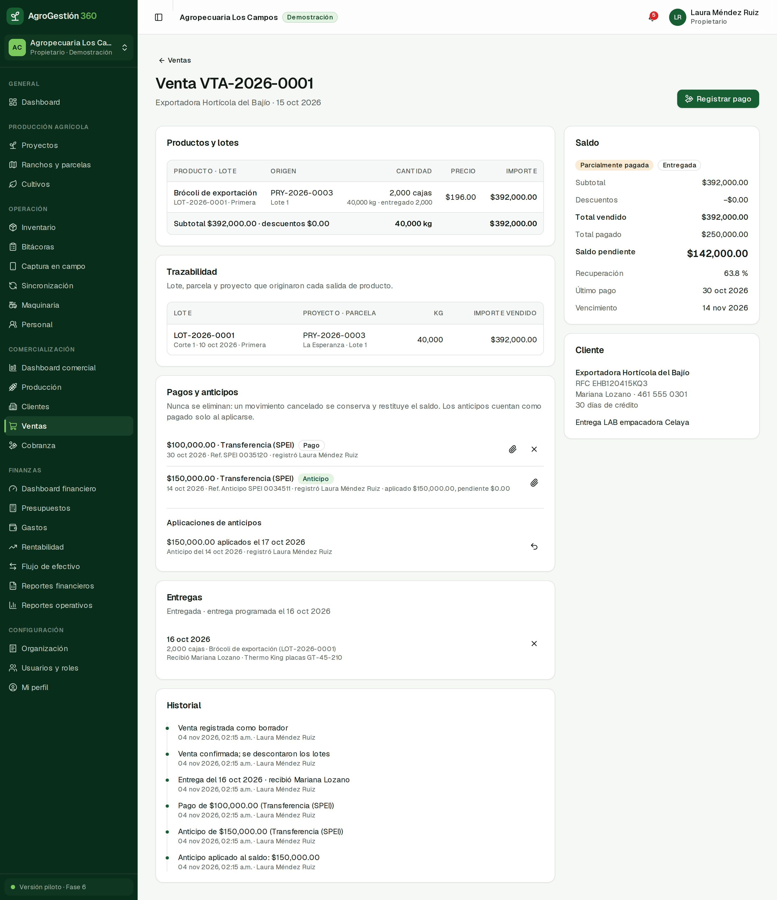
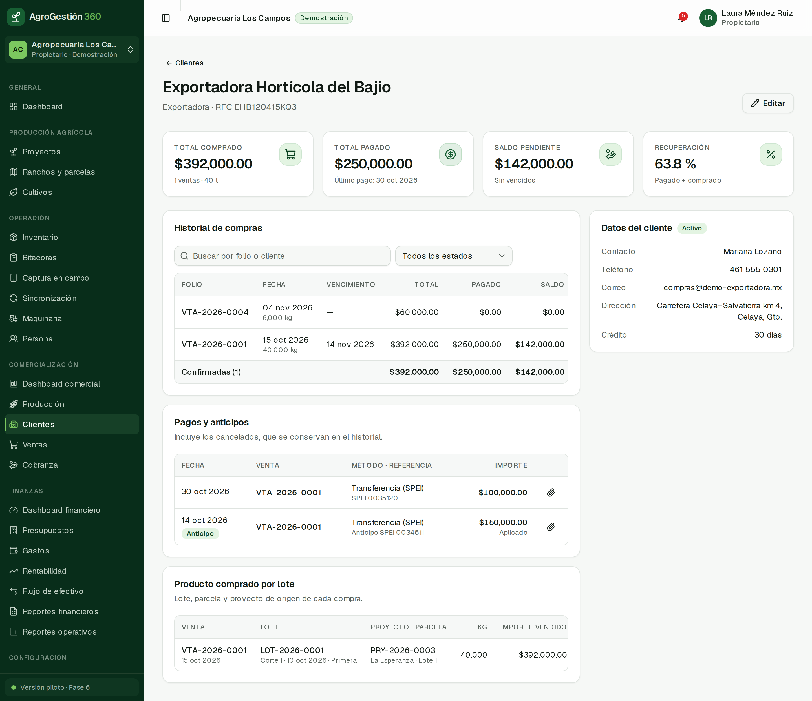

- **Ventas**: indicadores **Total vendido**, **Total pagado**, **Saldo pendiente** y **Recuperación**. La tabla se puede
  buscar por folio o cliente y filtrar por estado:
  - Borrador.
  - Confirmada.
  - Entregada.
  - Parcialmente pagada.
  - Pagada.
  - Cancelada.
- Detalle de la venta (pantalla **Venta VTA-AAAA-NNNN**, al pulsar el folio):
  - **Productos y lotes**.
  - **Trazabilidad**: lote, parcela y proyecto de origen.
  - **Pagos y anticipos**.
  - **Entregas**.
  - **Historial**: quién creó, confirmó o canceló, y cuándo.
  - **Saldo**.
  - **Cliente**.
- Expediente del cliente (pulsa su nombre en **Clientes**):
  - Indicadores **Total comprado**, **Total pagado**, **Saldo pendiente** y **Recuperación**.
  - **Historial de compras**.
  - **Pagos y anticipos**.
  - **Producto comprado por lote**.
- **Dashboard comercial**: ver el capítulo 15.

---

## 13. Control de pagos y cuentas por cobrar

**Quién puede:**

| Acción | Roles |
| ------ | ----- |
| Registrar pagos | Propietario, Administrador y Finanzas y ventas |
| Consultar | Rol Consulta |

### 13.1 Cómo registrar un pago

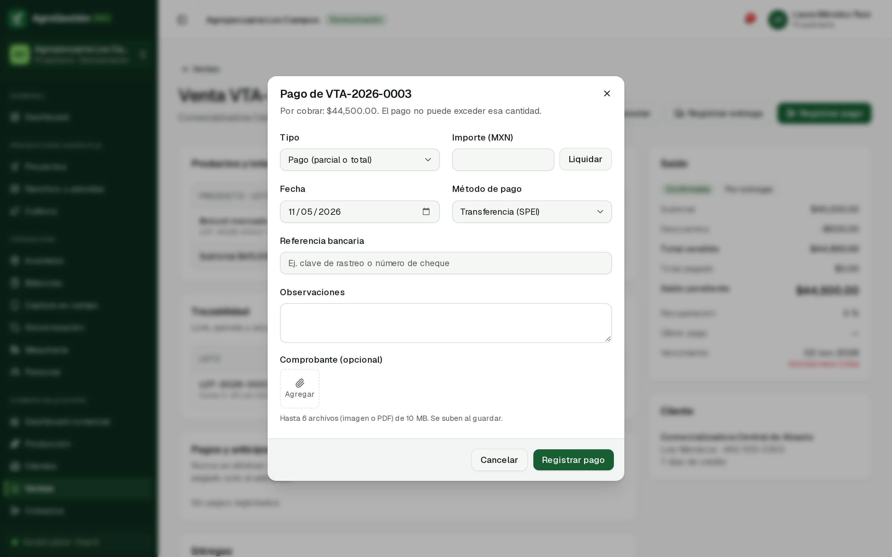

Desde el detalle de la venta (**Ventas →** folio) o desde **Comercialización → Cobranza** (tabla **Ventas con saldo**):

1. Pulsa **Registrar pago**.
2. En **Tipo** elige **Pago (parcial o total)**.
3. Captura **Importe (MXN)** y **Fecha**.
4. Elige el **Método de pago**: Transferencia (SPEI), Efectivo, Cheque, Depósito bancario u Otro.
5. Captura la **Referencia bancaria** (por ejemplo, la clave de rastreo) y **Observaciones**.
6. Adjunta el comprobante si lo tienes (ver 13.7).
7. Pulsa **Registrar pago**.

El pago no puede ser mayor que el saldo pendiente. Si lo es, verás «El pago (…) excede el saldo pendiente de la venta
(…)».

### 13.2 Cómo registrar anticipos

Un **anticipo** es dinero que el cliente entrega **antes** de que la venta esté confirmada o se aplique a su saldo.

1. **Recibir el anticipo.** En una venta en **Borrador**, pulsa **Registrar anticipo**. En una venta confirmada, elige el
   **Tipo** «Anticipo». Captura el importe y los demás datos.
2. **Aplicarlo.** El anticipo **no reduce el saldo** hasta que se aplica. Con la venta confirmada:
   1. En **Pagos y anticipos** pulsa **Aplicar**.
   2. Captura **Importe a aplicar** y **Fecha**.
   3. Pulsa **Aplicar al saldo**.
3. **Revertir.** La aplicación se puede revertir con **Revertir aplicación**. El importe vuelve a quedar como anticipo
   pendiente.

Los anticipos pendientes aparecen en **Cobranza → Anticipos pendientes de aplicar** y en el expediente del proyecto.

### 13.3 Cómo registrar pagos parciales

Registra un **Pago** por un importe menor al saldo. La venta pasa a **Parcialmente pagada** y el saldo se reduce.
Puedes registrar tantos pagos parciales como necesites.

### 13.4 Cómo consultar saldos

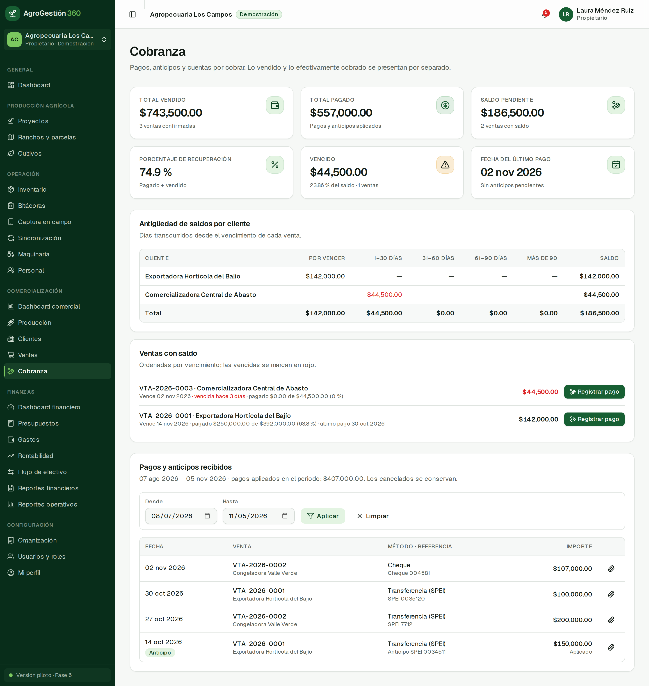

- Detalle de la venta, tarjeta **Saldo**: **Subtotal**, **Descuentos**, **Total vendido**, **Total pagado**,
  **Anticipos sin aplicar**, **Saldo pendiente**, **Recuperación**, **Último pago** y **Vencimiento**.
- **Cobranza**: indicadores **Total vendido**, **Total pagado**, **Saldo pendiente**, **Porcentaje de recuperación**,
  **Vencido** y **Fecha del último pago**.

### 13.5 Cómo identificar ventas pendientes

En **Cobranza → Ventas con saldo**, las ventas se ordenan por vencimiento y las vencidas se marcan en rojo. En
**Ventas** filtra por estado **Confirmada**, **Entregada** o **Parcialmente pagada**. La campana de notificaciones avisa
cuando hay cobranza vencida.

### 13.6 Cómo consultar pagos recibidos

- **Cobranza → Pagos y anticipos recibidos**.
- El detalle de cada venta.
- El expediente del cliente.
- El expediente del proyecto (**Pagos recibidos de esas ventas**).

Los pagos nunca se eliminan. **Cancelar** un pago exige un motivo y restituye el saldo; el pago cancelado queda en el
historial con la etiqueta **Cancelado**.

### 13.7 Cómo adjuntar comprobantes

- **Al registrar el pago:** usa **Comprobante (opcional)** → **Agregar**.
- **Después:** en la tabla de pagos, pulsa el ícono de **Comprobantes** → **Adjuntar comprobante**.

Se aceptan imágenes o PDF de hasta 10 MB.

### 13.8 Cómo identificar clientes con adeudos

- **Cobranza → Antigüedad de saldos por cliente**: días transcurridos desde el vencimiento de cada venta, por cliente.
- **Dashboard comercial**:
  - Indicador **Clientes con saldo pendiente**.
  - Gráfica **Saldos pendientes** por cliente.
- Expediente del cliente: **Saldo pendiente**, con la parte vencida.

### 13.9 Ejemplo completo: venta con pago parcial y pago de liquidación

Venta **VTA-2026-0001** a «Comercializadora del Centro» por **$196,000** (700 cajas de jitomate).

| Paso | Acción | Total pagado | Saldo pendiente | Estado |
| ---- | ------ | -----------: | --------------: | ------ |
| 1 | Se guarda la venta como **Borrador** | — | — (sin cuenta por cobrar) | Borrador |
| 2 | **Registrar anticipo** de $50,000 | $0 | — | Borrador |
| 3 | **Confirmar venta**: se descuentan 14,000 kg de los lotes | $0 | $196,000 | Confirmada |
| 4 | **Aplicar** el anticipo de $50,000 | $50,000 | $146,000 | Parcialmente pagada |
| 5 | **Registrar pago** parcial de $60,000 por transferencia, con comprobante | $110,000 | $86,000 | Parcialmente pagada |
| 6 | **Registrar pago** de liquidación: pulsa **Liquidar** para llenar los $86,000. Aparece «Con este pago la venta queda liquidada.» | $196,000 | $0 | Pagada |

Entre los pasos 2 y 4, el anticipo **sí** cuenta como dinero recibido en el **Flujo de efectivo**, pero **no** como cobro
de la venta hasta aplicarse.

---

## 14. Costos y presupuestos

**Quién puede:**

| Acción | Roles |
| ------ | ----- |
| Registrar presupuestos y gastos | Propietario, Administrador y Finanzas y ventas |
| Consultar | Rol Consulta |

Agrónomo, Supervisor y Almacén no tienen acceso a los módulos financieros.

### 14.1 Cómo crear un presupuesto

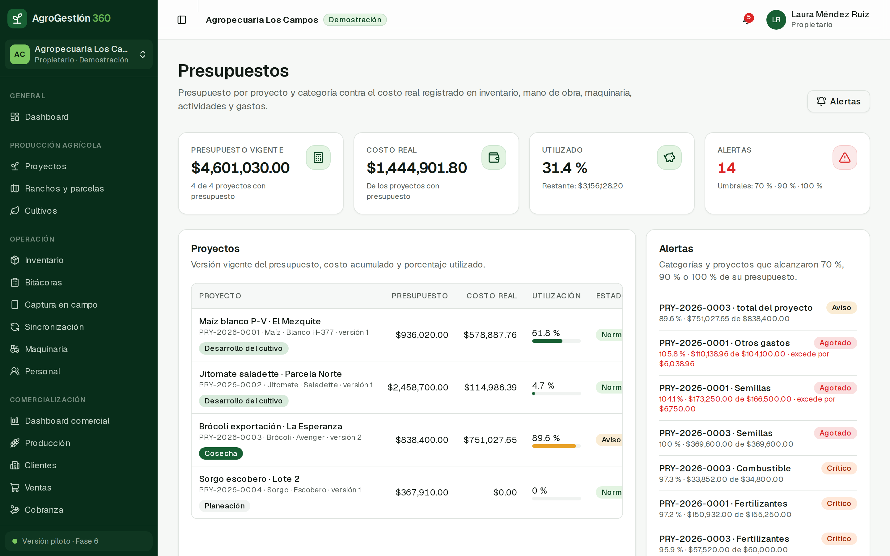

1. Ve a **Finanzas → Presupuestos**. En la tabla **Proyectos**, pulsa **Elaborar** en un proyecto «Sin presupuesto».
   También puedes abrir el proyecto y pulsar **Elaborar presupuesto**.
2. Captura **Inicio del periodo**, **Fin del periodo** y **Superficie (ha)**. Debajo se muestra la superficie asignada al
   proyecto.
3. En **Partidas**, por cada concepto captura:
   - **Categoría**: Preparación de terreno, Semillas, Fertilizantes, Agroquímicos, Riego, Mano de obra, Maquinaria,
     Combustible, Mantenimiento, Cosecha, Transporte u Otros gastos.
   - **Concepto**, **Unidad**, **Cantidad** y **Costo unitario**.
4. Revisa el **Presupuesto total** y pulsa **Guardar presupuesto**. Será la **versión 1** y se conservará aunque después se
   revise.

**Revisión:**
1. Pulsa **Nueva revisión**. Parte de la versión vigente.
2. Captura el **Motivo de la revisión** (obligatorio).
3. Pulsa **Guardar revisión**.

Se crea una versión nueva y la anterior se conserva sin cambios; consúltalas en **Versiones**. Si otra persona guardó
una revisión mientras editabas, la tuya se rechaza para no sobrescribirla.

### 14.2 Cómo registrar gastos

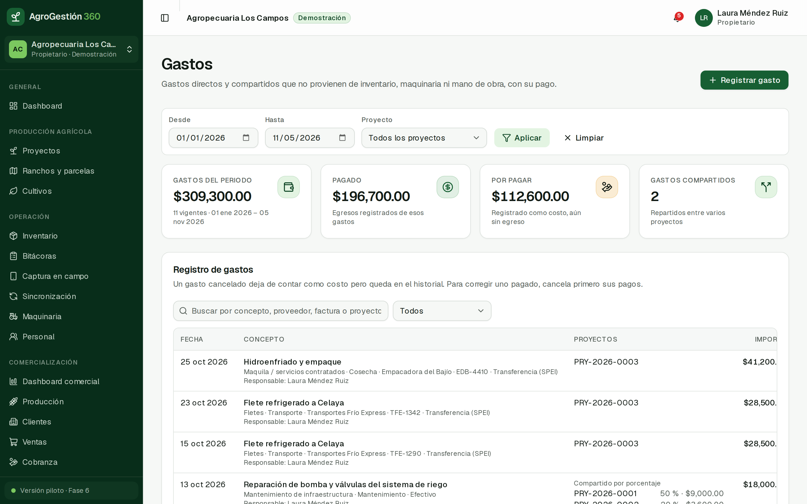
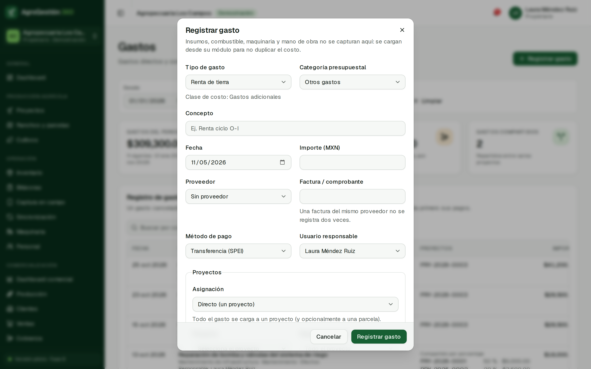

Los gastos son lo que **no** proviene de inventario, maquinaria ni mano de obra. Por ejemplo: renta de tierra, agua,
energía, fletes, servicios, seguros o intereses.

1. Ve a **Finanzas → Gastos** y pulsa **Registrar gasto**.
2. Captura:
   - **Tipo de gasto**: debajo se indica su clase de costo.
   - **Categoría presupuestal**.
   - **Concepto**.
   - **Fecha**.
   - **Importe (MXN)**.
   - **Proveedor**.
   - **Factura / comprobante**.
   - **Método de pago**.
   - **Usuario responsable**.
   - **Observaciones**.
   - Comprobante (opcional).
3. En **Proyectos**, elige la **Asignación**:

   | Asignación | Efecto |
   | ---------- | ------ |
   | Directo (un proyecto) | Todo el gasto a un proyecto |
   | Compartido por superficie | Se reparte según las hectáreas de cada proyecto |
   | Compartido en partes iguales | Partes iguales entre los proyectos elegidos |
   | Compartido por porcentaje | Indicas el % de cada proyecto |
   | Compartido por importe | Indicas el $ de cada proyecto |

   La tabla **Reparto que se registrará** muestra el reparto exacto, con centavos.
4. Si ya se pagó, marca **Ya está pagado** y captura **Fecha del pago** y **Referencia del pago**. El botón cambia a
   **Registrar y pagar**. Si no, pulsa **Registrar gasto**.

El gasto **cuenta como costo desde su fecha**, pero **no es egreso** hasta que se paga. Para pagar después:
1. Pulsa **Pagar** en la tabla y captura el importe (o pulsa **Liquidar**).
2. Captura **Fecha del pago**, **Método de pago** y **Referencia**.
3. Pulsa **Registrar pago**.

Reglas:
- La misma factura del mismo proveedor no se registra dos veces.
- Un gasto con pagos no se cancela: primero cancela sus pagos.

### 14.3 Cómo consultar costos por categoría

- **Presupuestos →** proyecto: tabla **Presupuesto contra gasto real** por categoría.
- **Dashboard financiero**: gráficas **Presupuesto contra costo real** y **Costos por categoría**. Esta última usa las
  siete clases: Insumos consumidos, Mano de obra, Maquinaria, Combustibles, Mantenimiento, Servicios y Gastos adicionales.
- **Reportes financieros**: reportes **Gastos por categoría** y **Costos de producción**.

### 14.4 Cómo identificar desviaciones presupuestarias

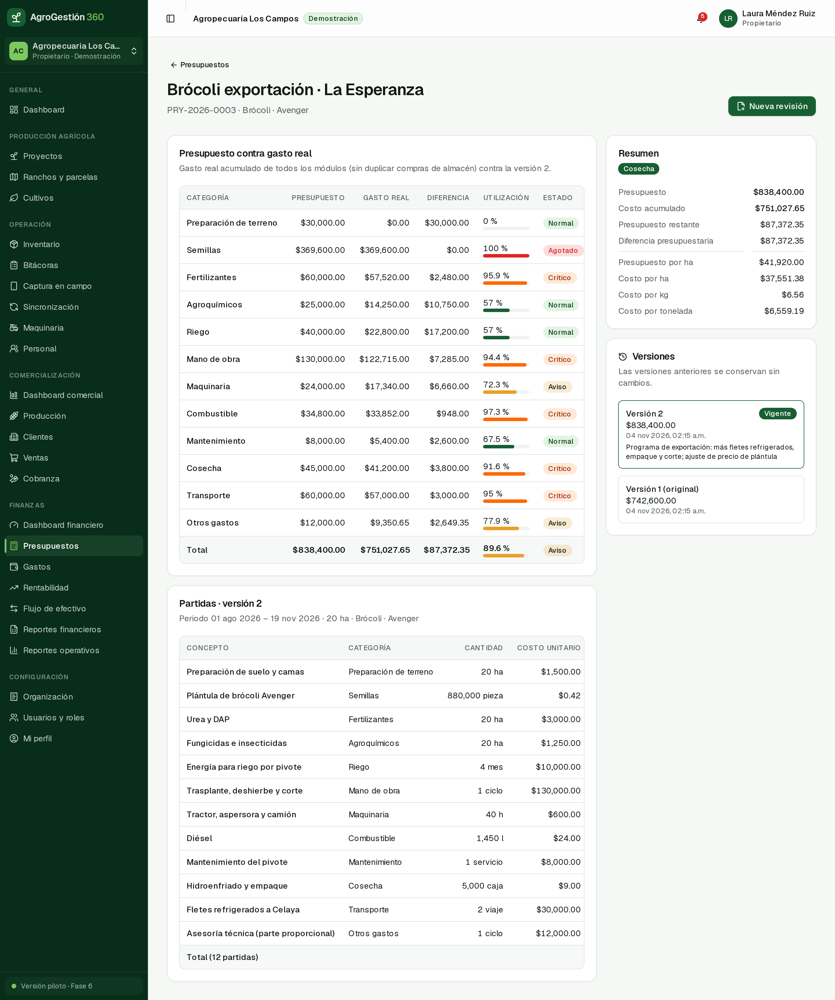

- En **Presupuestos**:
  - Indicadores **Presupuesto vigente**, **Costo real**, **Utilizado** y **Alertas**.
  - Tarjeta **Alertas**, con las categorías que alcanzaron un umbral.
- Cada proyecto o categoría muestra un estado según el porcentaje utilizado. Los umbrales por omisión son **Aviso 70 %**,
  **Crítico 90 %** y **Agotado 100 %**.
- Para cambiar los umbrales, pulsa **Alertas**, captura **Aviso (%)**, **Crítico (%)** y **Agotado (%)** y pulsa
  **Guardar umbrales**. Aplica a toda la organización y cada umbral debe ser mayor que el anterior.
- En el detalle del presupuesto: **Presupuesto restante** y **Diferencia presupuestaria**.

### 14.5 Cómo calcular el costo por hectárea

La aplicación lo calcula sola:

**Costo por hectárea = costo de producción acumulado ÷ superficie asignada**

**Ejemplo:** $66,560 ÷ 5 ha = **$13,312.00 por ha**.

Dónde consultarlo:
- Detalle del presupuesto (**Costo por ha**, junto a **Presupuesto por ha**).
- Expediente del proyecto.
- Dashboard financiero (gráfica **Costo por hectárea**).
- Reporte **Costo por hectárea**.

### 14.6 Cómo consultar el costo por kilogramo

**Costo por kg = costo de producción acumulado ÷ kg cosechados**

**Ejemplo:** $66,560 ÷ 30,000 kg = **$2.2187 por kg**.

Muestra «Sin cosecha» mientras no haya cortes. Dónde consultarlo:
- Detalle del presupuesto (**Costo por kg** y **Costo por tonelada**).
- Expediente del proyecto.
- Dashboard financiero (**Costo por unidad producida**).
- Reporte **Costo por kilogramo**.

### 14.7 Cómo revisar la rentabilidad estimada

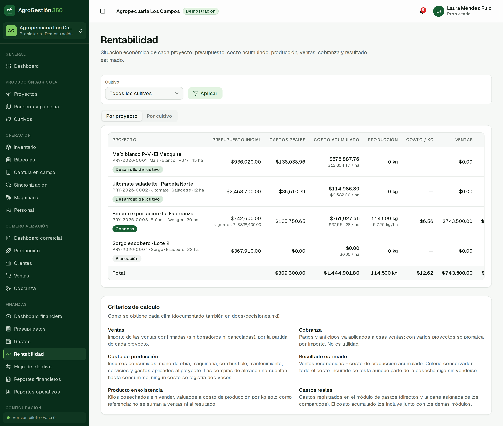

Ve a **Finanzas → Rentabilidad**. Tiene dos pestañas:
- **Por proyecto**: presupuesto inicial, gastos reales, costo acumulado, producción, rendimiento, costo unitario,
  ventas, cobrado, pendiente y margen.
- **Por cultivo**.

Se pueden filtrar por **Cultivo**. Al pie, **Criterios de cálculo** explica cada cifra.

### 14.8 Diferencia entre ventas, cobranza, costos y resultado

| Concepto | Qué es | Cuándo cuenta | Ejemplo (jitomate) |
| -------- | ------ | ------------- | ------------------ |
| **Ventas** | Valor de lo vendido en ventas **confirmadas** | Al confirmar la venta, aunque no se haya cobrado | $196,000 |
| **Cobranza** | Dinero recibido y **aplicado** a ventas (pagos y anticipos aplicados) | Al registrar el pago o aplicar el anticipo | $110,000 |
| **Cuentas por cobrar** | Ventas − cobranza | — | $86,000 |
| **Costo de producción** | Insumos consumidos + mano de obra + maquinaria + combustible + mantenimiento + servicios + gastos aplicados al proyecto | Al consumir o registrar, no al comprar ni al pagar | $66,560 |
| **Resultado estimado** | Ventas − costo de producción | — | $129,440 |
| **Flujo de efectivo** | Dinero que efectivamente entró y salió | En la fecha del cobro o del pago | Ingresos $110,000 · egresos $75,000 |

Puntos clave:
- **Cobrar no es ganar.** El cobro es dinero recibido; el resultado se calcula con ventas y costos.
- Una **compra de almacén** no es costo hasta consumirse, y su pago es un egreso.
- Un **gasto sin pagar** sí es costo, pero todavía no es egreso.
- Un **anticipo** es ingreso de efectivo al recibirse, pero no reduce la cuenta por cobrar hasta aplicarse.

---

## 15. Dashboard y reportes

### 15.1 Indicadores disponibles y cómo interpretarlos

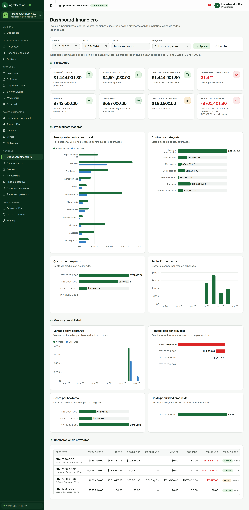
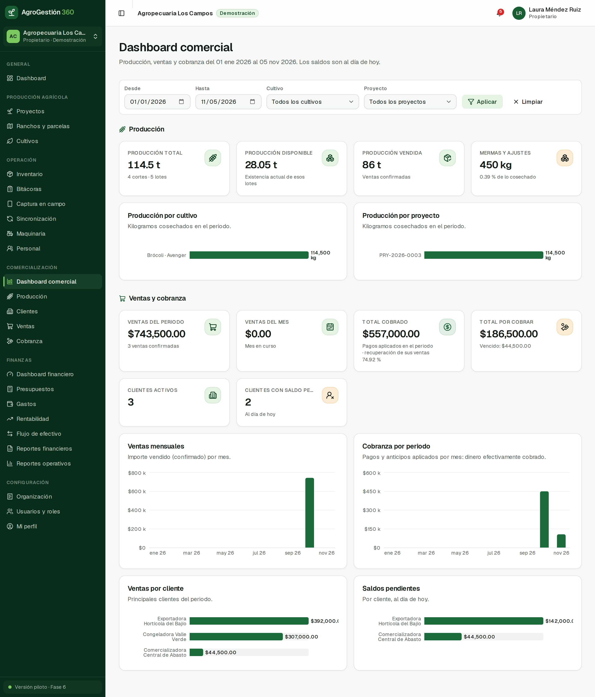


| Indicador | Dónde | Interpretación |
| --------- | ----- | -------------- |
| **Inversión** (Inversión acumulada / Inversión total) | Dashboard, Dashboard financiero | Costo de producción acumulado de los proyectos |
| **Presupuestos** (Presupuesto planeado / Presupuesto total / Presupuesto utilizado) | Dashboard, Dashboard financiero, Presupuestos | Suma de las versiones vigentes y el % ya consumido por el costo real |
| **Gastos** (Gastos del periodo / Costos reales del periodo) | Dashboard, Dashboard financiero, Gastos | Costos registrados en el periodo |
| **Producción** (Producción cosechada / Producción total / disponible / vendida) | Dashboard, Dashboard comercial, Producción | Kg o toneladas cosechados, en existencia y vendidos |
| **Ventas** (Ventas registradas / Ventas del periodo / Ventas del mes) | Dashboard, Dashboard comercial, Dashboard financiero | Ventas confirmadas; no es dinero cobrado |
| **Cobranza** (Dinero cobrado / Total cobrado / Cobranza) | Dashboard, Dashboard comercial, Dashboard financiero, Cobranza | Pagos y anticipos aplicados a las ventas |
| **Cuentas pendientes** (Cuentas por cobrar / Total por cobrar / Vencido / Por pagar) | Dashboard, Dashboard comercial, Cobranza, Flujo de efectivo | Lo vendido sin cobrar (y su parte vencida) y los gastos sin pagar |
| **Costos** (costo por ha, por kg, por clase, por proyecto) | Dashboard financiero, Presupuestos, expediente | Cuánto cuesta producir |
| **Rentabilidad** (Utilidad bruta / Resultado estimado) | Dashboard, Dashboard financiero, Rentabilidad | Ventas − costo de producción. Si es negativo se muestra en rojo |

**Dashboard comercial** (**Comercialización → Dashboard comercial**):
- **Producción**: **Producción total**, **Producción disponible**, **Producción vendida** y **Mermas y ajustes**, con las
  gráficas **Producción por cultivo** y **Producción por proyecto**.
- **Ventas y cobranza**:
  - Indicadores **Ventas del periodo**, **Ventas del mes**, **Total cobrado**, **Total por cobrar**, **Clientes activos**
    y **Clientes con saldo pendiente**.
  - Gráficas **Ventas mensuales**, **Cobranza por periodo**, **Ventas por cliente** y **Saldos pendientes**.
- Los saldos son al día de hoy.

**Dashboard financiero** (**Finanzas → Dashboard financiero**):
- **Indicadores**: Inversión total, Presupuesto total, Costos reales del periodo, Presupuesto utilizado, Ventas,
  Cobranza, Cuentas por cobrar y Resultado estimado.
- **Presupuesto y costos**: Presupuesto contra costo real, Costos por categoría, Costos por proyecto y Evolución de
  gastos.
- **Ventas y rentabilidad**: Ventas contra cobranza, Rentabilidad por proyecto, Costo por hectárea y Costo por unidad
  producida.
- **Comparación de proyectos**.

**Flujo de efectivo** (**Finanzas → Flujo de efectivo**):
- Indicadores **Ingresos**, **Egresos**, **Flujo neto**, **Por cobrar** y **Por pagar**.
- Gráficas **Ingresos contra egresos** y **Por tipo de movimiento**.
- Tablas **Movimientos de dinero**, **Gastos por pagar**, **Ventas por cobrar** y **Movimientos capturados**.

Con **Registrar movimiento** se capturan, en **Tipo**:
- **Pago a proveedor**: por ejemplo, el pago de compras de almacén.
- **Otro ingreso**: por ejemplo, un apoyo gubernamental.
- **Otro egreso**.

Los pagos de gastos se registran desde **Gastos**, y los cobros desde **Ventas** o **Cobranza**.

### 15.2 Cómo aplicar filtros

1. Captura **Desde** y **Hasta**.
2. Elige **Cultivo** y/o **Proyecto**, si la pantalla los ofrece.
3. Pulsa **Aplicar**. **Limpiar** regresa a los valores por omisión.

Al filtrar el Flujo de efectivo por proyecto, los cobros y pagos compartidos entre varios proyectos se prorratean.

### 15.3 Cómo consultar y descargar reportes


**Reportes operativos** (**Finanzas → Reportes operativos**). Disponibles para todos los roles:

| Reporte | Contenido |
| ------- | --------- |
| Consumo de insumos | Consumos menos devoluciones por proyecto y producto, a costo histórico |
| Existencias | Existencia actual por almacén y lote, con valor (no depende del periodo) |
| Por caducar | Lotes que caducan en los próximos días o ya caducados |
| Riegos | Historial de riegos por proyecto y parcela |
| Aplicaciones | Aplicaciones con ingrediente activo, cantidad por ha, reentrada e intervalo de seguridad |
| Jornadas | Días, jornales y destajos por trabajador |
| Mano de obra | Costo por proyecto y actividad |
| Maquinaria | Horas, cargo a proyectos, combustible y mantenimiento |
| Costos operativos | Insumos, maquinaria, mano de obra y actividades por proyecto |

**Reportes financieros** (**Finanzas → Reportes financieros**). Roles con acceso a finanzas:

| Reporte | Contenido |
| ------- | --------- |
| Estado financiero | Por proyecto: presupuesto, costo, ventas, cobranza, saldo y resultado |
| Presupuestos | Presupuesto contra real |
| Gastos por categoría | Gastos agrupados por categoría |
| Costos de producción | Costo por proyecto y clase |
| Costo por hectárea | Costo ÷ superficie |
| Costo por kilogramo | Costo ÷ kg cosechados |
| Rentabilidad por cultivo | Resultado agregado por cultivo |
| Ventas y cobranza | Vendido contra cobrado |
| Cuentas pendientes | Por cobrar y por pagar |
| Comparación de proyectos | Indicadores lado a lado |

Pasos:
1. Elige el reporte en la fila de pestañas superior.
2. Aplica los filtros: periodo y proyecto; en los financieros también cultivo.
3. Descarga con los botones de la esquina:

   | Botón | Formato | Disponible en |
   | ----- | ------- | ------------- |
   | **CSV** | Archivo de texto para cualquier hoja de cálculo | Ambos tipos de reporte |
   | **Excel** | .xlsx, con números y fechas reales | Solo reportes financieros |
   | **PDF** | Abre la impresión del navegador, solo del reporte abierto; elige «Guardar como PDF» | Solo reportes financieros |

> **Limitación.** Los reportes operativos solo se descargan en CSV.

---

## 16. Usuarios y permisos

### 16.1 Roles implementados

AgroGestión 360 tiene **siete roles**. Cada persona tiene un rol por organización.

| Rol | Descripción en la aplicación |
| --- | ---------------------------- |
| **Propietario** | Acceso completo a la organización. |
| **Administrador** | Gestión general de operaciones y usuarios. |
| **Agrónomo** | Administración de proyectos y actividades agrícolas. |
| **Supervisor de campo** | Consulta y captura de actividades de campo. |
| **Almacén** | Control de inventarios y movimientos. |
| **Finanzas y ventas** | Presupuestos, gastos, flujo de efectivo, ventas y cobranza. |
| **Consulta** | Acceso de solo lectura. |

### 16.2 Qué puede hacer cada rol

✔ = registra o modifica · 👁 = solo consulta · — = sin acceso («Sin acceso a este módulo»)

| Área | Propietario | Administrador | Agrónomo | Supervisor | Almacén | Finanzas | Consulta |
| ---- | :---------: | :-----------: | :------: | :--------: | :-----: | :------: | :------: |
| Organización y usuarios | ✔ | ✔ ¹ | 👁 | 👁 | 👁 | 👁 | 👁 |
| Ranchos, parcelas, cultivos | ✔ | ✔ | ✔ (no elimina) | 👁 | 👁 | 👁 | 👁 |
| Proyectos | ✔ | ✔ | ✔ (no elimina ni reabre) | 👁 | 👁 | 👁 | 👁 |
| Bitácoras y captura en campo | ✔ | ✔ | ✔ | ✔ | 👁 | 👁 | 👁 |
| Revisión de sincronización | ✔ | ✔ | ✔ | Solo lo propio | Solo lo propio | Solo lo propio | Solo lo propio |
| Inventario (productos, catálogos y movimientos) | ✔ | ✔ | 👁 | 👁 | ✔ | 👁 | 👁 |
| Maquinaria y empleados | ✔ | ✔ | ✔ | 👁 | 👁 | 👁 | 👁 |
| Jornadas y asistencia | ✔ | ✔ | ✔ | ✔ | 👁 | 👁 | 👁 |
| Cortes de producción | ✔ | ✔ | ✔ | ✔ | 👁 | 👁 | 👁 |
| Mermas de producto | ✔ | ✔ | ✔ | ✔ | ✔ | 👁 | 👁 |
| Clientes, ventas y cobranza | ✔ | ✔ | — | — | — | ✔ | 👁 |
| Presupuestos, gastos, flujo, rentabilidad, dashboards y reportes financieros | ✔ | ✔ | — | — | — | ✔ | 👁 |
| Reportes operativos | 👁 | 👁 | 👁 | 👁 | 👁 | 👁 | 👁 |
| Actividad reciente (auditoría) | ✔ | ✔ | — | — | — | — | — |

¹ El Administrador no puede asignar el rol Propietario ni modificar a un Propietario.

Las reglas también se aplican en la base de datos: aunque alguien intentara saltarse la pantalla, el registro se rechaza
con «No tienes permiso para realizar esta operación».

### 16.3 Ejemplos de acceso por rol

- **Propietario.** Ve todos los módulos y todos los indicadores del Dashboard, incluida la **Actividad reciente**. Invita usuarios, cambia roles y es el único que puede asignar a otro Propietario.
- **Administrador.** Igual que el propietario en la operación diaria. Puede invitar y editar usuarios, excepto a los
  propietarios.
- **Agrónomo.** Crea proyectos, asigna parcelas y cambia estados (sin reabrir). Administra cultivos, ranchos, maquinaria,
  empleados y cuadrillas, y registra bitácoras, jornadas y cortes. Revisa la **Sincronización** del equipo. Al abrir
  **Ventas**, **Gastos** o cualquier pantalla de Finanzas ve «Sin acceso a este módulo».
- **Supervisor de campo.** Registra riegos, aplicaciones, actividades, jornadas, asistencia, cortes y mermas, también
  desde **Captura en campo** sin conexión. No mueve inventario ni administra equipos. No ve ventas, cobranza ni finanzas.
- **Almacén.** Registra productos y movimientos de inventario (entradas, consumos, transferencias, ajustes) y mermas de
  producto. No registra pagos ni gastos y no ve los módulos financieros.
- **Finanzas y ventas.** Registra clientes, ventas, entregas, pagos, anticipos, presupuestos, gastos y movimientos de
  efectivo. Consulta los dashboards y reportes financieros. En el campo solo consulta.
- **Consulta.** Ve toda la información, incluidas las finanzas, pero no ve botones de captura. Si intenta un registro,
  se rechaza.

> **Nota.** Los roles de campo (Agrónomo, Supervisor, Almacén) **sí ven** costos operativos como tarifas de jornal o el
> costo de los insumos en Personal e Inventario. Lo que no ven son ventas, pagos, gastos e importes financieros.

### 16.4 Cómo administrar usuarios


Solo Propietario y Administrador. Ve a **Configuración → Usuarios y roles**.

- **Invitar usuario:**
  1. Pulsa **Invitar usuario**.
  2. Captura **Correo electrónico** y **Rol**. Debajo se muestra la descripción del rol.
  3. Pulsa **Enviar invitación**.

  La invitación aparece en **Invitaciones pendientes** hasta que la persona crea su cuenta. Para anularla, usa **Cancelar
  invitación**.
- **Cambiar rol o desactivar:**
  1. Pulsa el lápiz (**Editar a …**) del miembro.
  2. Cambia **Rol** o **Estado** (Activo / Inactivo (sin acceso)).
  3. Pulsa **Guardar** o **Desactivar usuario**.

  Reglas:
  - No puedes desactivar tu propia cuenta.
  - La organización siempre conserva al menos un propietario.
  - Al desactivar a alguien, su historial se conserva.
- **Roles disponibles** muestra la descripción de cada rol.
- **Datos de la organización:** en **Configuración → Organización**, captura **Nombre comercial**, **Razón social**,
  **RFC**, **Correo de contacto**, **Teléfono** y **Domicilio**, y pulsa **Guardar cambios**. Ahí también se ven la
  **Configuración regional** y el **Plan** con su uso (proyectos vigentes, usuarios y almacenamiento). Para cambiar de plan
  hay que contactar a AgroGestión 360.

---

## 17. Problemas frecuentes

**No puedo iniciar sesión.**

| Mensaje | Solución |
| ------- | -------- |
| «Correo o contraseña incorrectos.» | Revisa mayúsculas y espacios. Si no recuerdas la contraseña, usa **¿Olvidaste tu contraseña?** (3.4). |
| «Debes confirmar tu correo electrónico antes de iniciar sesión.» | Abre el enlace de confirmación que te llegó al registrarte. |
| Entras, pero ves **Bienvenido** pidiendo crear una organización | Tu cuenta no pertenece a ninguna empresa. Si te invitaron, pide al administrador que te envíe la invitación a ese mismo correo. |
| «El enlace de invitación no es válido o ya expiró.» | Pide una nueva invitación. |
| Tu usuario fue desactivado | El administrador debe reactivarlo en **Usuarios y roles**. |

**No puedo guardar un registro.**
- Revisa los campos marcados en rojo («Revisa los datos marcados en el formulario.»).
- «No tienes permiso para realizar esta operación.»: tu rol no permite ese registro (capítulo 16).
- «Ya existe un registro con esos datos.»: la clave o el nombre ya existen.
- El proyecto está **Cerrado** o **Cancelado**: ya no admite cambios de parcelas ni registros nuevos.
- Las fechas futuras no se aceptan («No puede ser una fecha futura»).

**No aparece un proyecto.**
- En **Proyectos**, el filtro muestra **Vigentes** por omisión. Elige **Todos los estados** para ver cerrados y
  cancelados.
- En **Registrar corte** solo aparecen proyectos en **Cosecha** o **Comercialización**. En bitácoras, consumos y jornadas
  solo aparecen proyectos vigentes.
- Revisa que estés en la organización correcta (selector del menú lateral).
- Si una parcela no aparece al registrar algo, debe estar asignada al proyecto (5.3).
- En **Captura en campo**, pulsa **Actualizar** con conexión para descargar los proyectos nuevos.

**No puedo registrar una salida de inventario.**
- «Existencia insuficiente de "…" en …: hay … y se requieren …»: la existencia se valida **por almacén**. Revisa
  **Por almacén y lote** y, si hace falta, haz una **Transferencia**.
- «Indica el lote de "…"»: el producto se controla por lote; elige el **Lote**.
- «El lote … caducó el …; regístralo como ajuste por merma»: no se consume un lote caducado.
- Tu rol debe ser Propietario, Administrador o Almacén. Agrónomo y Supervisor descuentan del almacén solo mediante
  aplicaciones (8.2); el Agrónomo, también con el combustible de maquinaria (9.4).

**El inventario no coincide.**
- Revisa la pestaña **Movimientos** del producto con filtros de fecha: entradas, consumos (incluidos los de etiqueta
  **Desde bitácora**), devoluciones, transferencias y anulaciones.
- Corrige un conteo físico con **Ajuste positivo** o **Ajuste negativo / merma**. Nunca borres movimientos: un error se
  corrige con **Anular**.
- El valor del inventario es existencia × costo promedio. Las transferencias no cambian el valor.

**No puedo registrar una cosecha.**
- El proyecto debe estar en **Cosecha** o **Comercialización**: cámbialo con **Cambiar estado** (5.9).
- La parcela debe estar asignada al proyecto.
- En unidades distintas de kg o toneladas falta el **Peso neto por unidad (kg)**.
- Sin conexión, el corte queda **Requiere revisión** si el proyecto no estaba en cosecha al sincronizar.

**No puedo vender determinada cantidad.**
- «El lote … tiene … kg disponibles y la venta requiere … kg»: solo se vende lo disponible de cada lote (inicial −
  vendido − mermas). Revisa **Producción → Inventario de producto**.
- Otro borrador confirmado antes pudo agotar el lote.
- «La fecha de venta es anterior a la cosecha del lote …»: corrige la fecha.

**No puedo registrar un pago.**
- «El pago (…) excede el saldo pendiente de la venta (…)»: registra como máximo el saldo. Usa **Liquidar** para llenarlo.
- «El saldo de la venta … está cubierto por anticipos sin aplicar; aplícalos»: usa **Aplicar** en el anticipo (13.2).
- En un borrador solo se registran **anticipos**. Confirma la venta para registrar pagos.
- Tu rol debe ser Propietario, Administrador o Finanzas y ventas.

**No aparecen los indicadores.**
- Los indicadores financieros solo aparecen para Propietario, Administrador, Finanzas y ventas y Consulta.
- Revisa los filtros de fecha y proyecto: muchos indicadores son del periodo elegido. Pulsa **Limpiar**.
- Costo por kg y rendimiento muestran «Sin cosecha» hasta registrar cortes.
- El presupuesto utilizado requiere un presupuesto elaborado (14.1).

**No puedo consultar un reporte.**
- Los **Reportes financieros** muestran «Sin acceso a este módulo» a Agrónomo, Supervisor y Almacén.
- Si la tabla sale vacía, amplía el periodo o quita el filtro de proyecto.
- Excel y PDF solo existen en los reportes financieros. En los operativos usa **CSV**.
- Para PDF, permite las ventanas de impresión del navegador.

**La información no se sincroniza.**
- Revisa el indicador de la barra superior y la pestaña **Registros** de **Captura en campo**.
- «Tu sesión expiró. Inicia sesión para enviar los registros.»: inicia sesión con la misma cuenta; los registros se
  conservan.
- «No hay conexión con el servidor. Se reintentará automáticamente.»: espera la señal o pulsa **Sincronizar**.
- **Requiere revisión**: lee el motivo, pulsa **Corregir** y luego **Reintentar**, o pide a un agrónomo o administrador que
  corrija la causa en **Sincronización**.
- **Descartado**: el revisor lo anuló con motivo; vuelve a capturarlo si corresponde.
- «Sin catálogos en este dispositivo»: abre **Captura en campo** una vez con conexión y la sesión iniciada.
- En iPhone, instala la aplicación y ábrela con señal al menos una vez al día. No hay sincronización en segundo plano.

**La aplicación muestra un mensaje de error.**
- «Ocurrió un error inesperado. Intenta de nuevo.»: revisa tu conexión y repite la operación. Los registros se guardan
  sin duplicarse aunque los envíes dos veces.
- «Sin conexión — Esta sección necesita internet»: recupera la señal o usa **Ir a captura en campo**.
- «Sin acceso a este módulo»: tu rol no puede ver esa pantalla.
- Si el error persiste, anota la pantalla, la hora y el mensaje exacto y repórtalo al administrador de la aplicación.

---

## Anexo A. Estado de los módulos

El detalle completo (método, evidencia de cada módulo, defectos y permisos) está en el
[Inventario de funcionalidades](../analisis/inventario_funcionalidades.md). Resumen al 5 de noviembre de 2026 (commit
`49f3644`):

| Estado | Funcionalidades |
| ------ | --------------- |
| **Implementado** | Dashboard y notificaciones, proyectos, ranchos y parcelas, cultivos, inventario, bitácoras de riego, aplicaciones y actividades, cronología, evidencias, sincronización, maquinaria, personal, producción y lotes, trazabilidad, clientes, ventas, entregas, cobranza, presupuestos, gastos, rentabilidad, flujo de efectivo, reportes financieros, acceso, multiempresa, organización, perfil, permisos por rol e indicador de conexión. |
| **Parcial** | Observaciones de campo (sin botón en Bitácoras y fuera de la cronología), captura sin conexión (solo cinco tipos de registro), reportes operativos (solo CSV), invitaciones (correo en inglés), plan y límites (informativo), bitácora de auditoría (sin pantalla de consulta). |
| **Pendiente** | Cobro de suscripciones y facturación, eliminar una organización desde la interfaz, importación masiva de datos. |
| **No verificado** | Recuperación de contraseña por correo, instalación en un dispositivo real, sincronización en segundo plano. |

Pruebas que respaldan este manual (5 de noviembre de 2026):

| Prueba | Resultado |
| ------ | --------- |
| Unitarias (`npm test`) | 145 de 145 ✅ |
| Base de datos y permisos (`npm run test:db`) | 450 de 450 ✅ |
| Integración con usuarios reales (`npm run test:integration`) | 67 de 67 ✅ |
| Navegador, escritorio y móvil (`npm run test:e2e`) | 32 de 32 ✅ |
| Pruebas funcionales desde la pantalla ([matriz](../pruebas/matriz_resultados_pruebas.md)) | 32 ejecutadas: 25 aprobadas, 7 parciales, 0 rechazadas |
